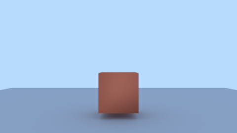
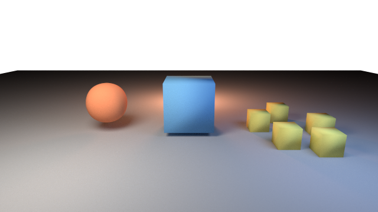
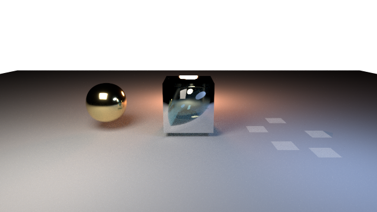
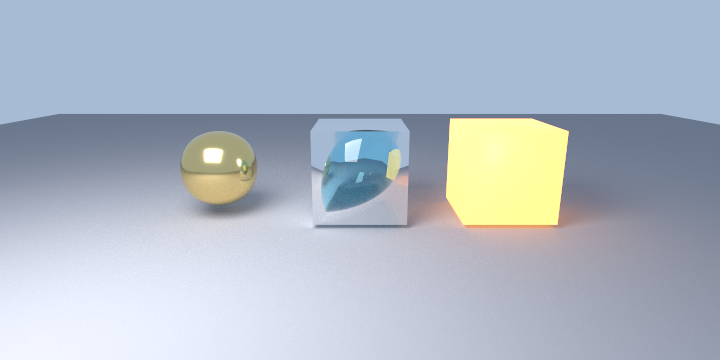
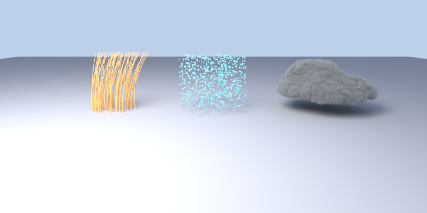
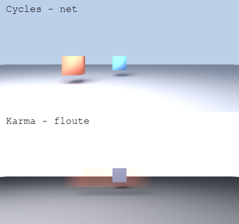
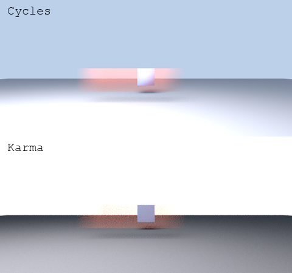
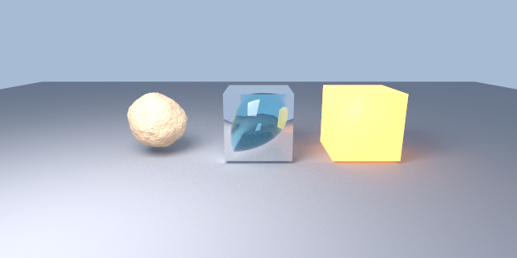
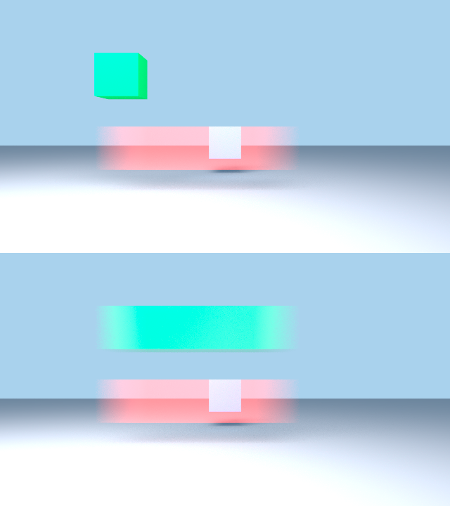
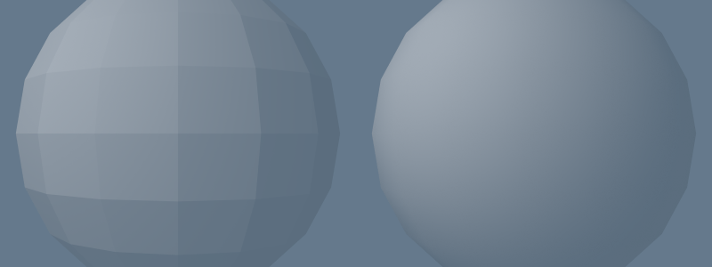

# Journal d'avancement

> Ce fichier est le **journal** : ce qui a été tenté, mesuré et décidé, phase
> par phase, dans l'ordre. Il ne décrit pas l'état courant — plusieurs
> conclusions ci-dessous ont été corrigées depuis. L'état courant est dans
> [PROGRESS.md](PROGRESS.md), les défauts connus dans
> [KNOWN_ISSUES.md](KNOWN_ISSUES.md), la suite dans [PLAN.md](PLAN.md). La
> carte des documents est [README.md](README.md).

## Phase 0 — Build ✅

Cycles 5.2 (`3b97e190`) compile et s'installe contre **Houdini 22.0.368 / USD 26.05**.

- Configuration CMake : aucune erreur, aucun conflit TBB/OIIO/OpenVDB.
- Un correctif nécessaire : `patches/0001-FindUSDHoudini-add-hdsi.patch`.
- Sortie : `install/houdini/dso/usd/hdCycles.dll` (10 Mo) + `plugInfo.json`
  + package `cycles.json`.

Lancement :

    $env:PXR_PLUGINPATH_NAME = "<projet>/install/houdini/dso/usd_plugins"

`husk --list-renderers` affiche alors `HdCyclesPlugin (Cycles)`, **non marqué
"unsupported"**.

## Phase 1 — Delegate enregistré ✅

## Phase 2 — Première image ✅



Rendu par : `husk --renderer HdCyclesPlugin --camera /world/camera --res 480 270
--output geo.exr geo_only.usda`

Validé : mesh polygonaux, transforms, DomeLight (couleur + intensité),
displayColor, ombres de contact, path tracing sur 128 threads
(Threadripper 3995WX), échantillonnage adaptatif.

## Phase 3 — Lumières, instancing, subdivision ✅



Validé sur `tests/usd/phase3.usda` :

- **Subdivision Catmull-Clark** — le cube de gauche est rendu comme une sphère
  lisse, le cube central (`subdivisionScheme = "none"`) reste dur.
- **PointInstancer** — les 5 instances sont rendues, avec la couleur du
  prototype (après correctif 0003).
- **RectLight, DiskLight, SphereLight** — les trois contribuent, avec leurs
  couleurs et leurs ombres douces respectives.
- **displayColor** par objet.

Méthode : chaque résultat est contre-vérifié en rendant la même scène avec
Karma. C'est ce qui a permis de distinguer un vrai bug du delegate (0003) d'une
scène de test mal écrite.

## Phase 4a — Nœuds Cycles natifs dans USD ✅



**161 nœuds Cycles** sont publiés dans le registre Sdr d'USD (patch 0004), avec
leurs types, valeurs par défaut et options d'enum lues du registre Cycles.

L'image ci-dessus est rendue depuis des matériaux authorés **en nœuds Cycles
natifs** dans un fichier USD : `cycles_principled_bsdf` en or métallique
(`metallic=1`, `roughness=0.12`) et en verre (`transmission_weight=1`,
`ior=1.45`).

Prérequis découvert : les meshes doivent porter le schéma appliqué
`MaterialBindingAPI`. Sans lui, `rel material:binding` est silencieusement
ignoré et la géométrie retombe sur `default_surface` — le rendu est correct
mais sans aucun matériau, ce qui est trompeur.

## Phase 4b — Traduction MaterialX ✅



Les trois objets ci-dessus sont rendus depuis des matériaux **MaterialX**
`ND_standard_surface_surfaceshader` : métal (`metalness=1`,
`specular_roughness=0.14`), verre (`transmission=1`, `specular_IOR=1.45`) et
émission (`emission=2.5`).

Implémenté dans le patch 0006, en réutilisant la machinerie de mapping déjà
présente pour `UsdPreviewSurface` plutôt qu'en créant une seconde. Les noms de
sockets Cycles ont été relevés depuis le registre Sdr construit en phase 4a —
pas devinés.

La couche est volontairement un bloc auto-contenu dans `material.cpp` :
supprimable d'une pièce le jour où Cycles absorbera MaterialX, comme prévu au
départ. `src/mtlxCycles` n'a donc pas lieu d'être, la greffe sur l'existant
étant plus courte et plus cohérente.

Couvert : `standard_surface`, `image`, `normalmap`, `texcoord`. Les entrées
MaterialX sans équivalent Cycles (`base`, `transmission_color`,
`subsurface_color`, `transmission_extra_roughness`) sont délibérément non
mappées et ignorées — c'est documenté dans le code.

## Phase 5 — Curves, points, volumes ✅



Validé sur `tests/usd/phase5.usda` :

- **BasisCurves** — 60 courbes cubiques bspline, largeurs dégressives par
  vertex, rendues comme des cheveux natifs Cycles.
- **Points** — 900 points, largeurs variables.
- **Volume OpenVDB** — le `cloud.vdb` livré avec Houdini, chargé via un prim
  `OpenVDBAsset`, avec auto-ombrage et ombre portée.

Le volume ne s'affichait pas au premier essai. Les logs montraient pourtant la
texture NanoVDB allouée (3,45 Mo) — mais aussi `Use Volume False` et
`0 volume octree(s)`. Cause : un volume sans matériau recevait le shader de
surface par défaut. Corrigé par le patch 0007.

## Phase 6 — AOVs ✅ / motion blur ⚠️

### AOVs : validés

`tests/usd/phase6_aov.usda` produit quatre RenderProducts distincts, tous
corrects et non triviaux :

| AOV | Canaux | Contrôle |
|---|---|---|
| `C` (color) | 4 (RGBA) | max 11,86 — le cube émissif |
| `Pz` (depth) | 1 | max 1e10 sur le fond, la profondeur « infinie » standard |
| `N` (normal) | 3 | valeurs bornées à ±1, normales normalisées |
| `primId` | 1 | max 4 pour 5 prims, identifiants 0..4 |

Les alias de nommage Houdini (`C`, `Pz`, `N`) passent par le patch 0002.

### Motion blur d'objet : absent



Voir l'anomalie A7 ci-dessous.

## Phase 9 — Réglages de rendu et packaging ✅

### Réglages exposés

Le delegate accepte, depuis un prim `RenderSettings` USD :

| Clé | Effet |
|---|---|
| `cycles:samples` | nombre d'échantillons |
| ~~`cycles:device`~~ | **n'arrive jamais sous husk** — voir phase 18 |
| ~~`cycles:threads`~~ | idem |
| `cycles:time_limit` | limite de temps |
| `cycles:sample_offset` | décalage d'échantillons |
| `cycles:integrator:<socket>` | **tout** socket de l'intégrateur |

Vérifié : `cycles:samples = 24` rend bien 24 échantillons contre 1024 par
défaut ; `cycles:integrator:max_bounce` à 0 contre 12 change la luminance
moyenne comme attendu (perte de l'illumination indirecte).

⚠️ Les noms de sockets sont ceux de Cycles, pas ceux de l'UI Blender :
c'est **`max_bounce`** au singulier, pas `max_bounces`. Un nom erroné était
ignoré sans un mot — le patch 0008 ajoute un avertissement.

La liste complète des sockets disponibles se lit dans
`external/cycles/src/scene/integrator.cpp`.

### Packaging

`install/houdini/` contient désormais :

- `packages/cycles.json` — package Houdini (généré par le build amont)
- `UsdRenderers.json` — label de menu et défauts husk (patch 0008)
- `dso/usd/hdCycles.dll` + `dso/usd_plugins/hdCycles/` — le delegate et son manifeste

Installation : copier `install/houdini/packages/cycles.json` dans
`%USERPROFILE%/Documents/houdini22.0/packages/`.

**Reste à vérifier par toi** : l'effet de `UsdRenderers.json` sur le menu de
renderers de Solaris ne se constate que dans l'interface.

## Anomalies ouvertes

### A1 — Surfaces implicites non supportées (confirmé)

`kSupportedRPrimTypes` (`src/hydra/render_delegate.cpp:40`) ne liste que
`basisCurves`, `mesh`, `points`, `volume`. Un prim `Sphere` USD est
silencieusement absent du rendu ; un `Mesh` explicite au même endroit
s'affiche correctement.

Impact réel modéré (la géométrie venant des SOPs arrive en mesh), mais toute
scène USD tierce contenant Sphere/Cube/Cylinder/Cone/Capsule perdra ces prims
sans avertissement.

Piste : s'assurer que `UsdImagingImplicitSurfaceSceneIndex` est bien inséré
dans la pipeline husk d'Houdini 22, sinon déclarer les types et mailler
nous-mêmes.

### A2 — RenderVar Houdini → image noire ✅ RÉSOLU (patch 0002)

husk transmet `driver:parameters:aov:husk:name` comme nom d'AOV Hydra. La
convention Houdini pour la beauty étant `"C"`, le binding n'était pas mappé,
la liste de bindings restait vide, `IsConverged()` retournait vrai
immédiatement et husk écrivait une frame vierge — **sans le moindre
avertissement**.

Diagnostic obtenu par bissection : RenderSettings seuls → OK ; ajout du
RenderProduct + RenderVar → noir ; `husk:name = "color"` → OK.

### A3 — displayColor perdu sur les instances ✅ RÉSOLU (patch 0003)

Index `_instances[0]` codé en dur. Voir `patches/README.md`.

### A4 — Matériau à émission seule : invisible à la caméra

Un `Material` dont le terminal `outputs:cycles:surface` est connecté
directement à un nœud `cycles_emission` **émet bien de la lumière** (la lueur
colorée est visible sur les surfaces alentour) mais l'objet lui-même est
**totalement invisible aux rayons caméra**.

La même émission passée par les entrées `emission_color` / `emission_strength`
d'un `cycles_principled_bsdf` rend un objet lumineux visible, normalement.

Le défaut est donc spécifique au nœud `emission` employé seul comme terminal de
surface, et non à l'émission en général. Cause racine non déterminée — piste :
la construction du graphe côté `material.cpp`, la fermeture d'émission étant
visiblement prise en compte par l'arbre de lumières mais pas raccordée à la
sortie de surface.

Reproduction : `tests/usd/emit_test.usda` (invisible) contre
`tests/usd/pemit_test.usda` (correct).

### A5 — Crash sur matériau MaterialX ✅ RÉSOLU (patch 0005)

La simple présence d'un matériau MaterialX dans le stage provoquait un
segmentation fault, lié ou non à une géométrie. Karma rendait le même fichier
sans problème.

Cause racine : `Shader::tag_update()` déréférence `graph` sans vérification,
et un matériau dont la network est illisible n'atteint jamais `set_graph()`.
Corrigé en semant un graphe vide à la création du shader.

Localisé par instrumentation progressive (`fprintf` sur stderr — `TF_WARN` est
avalé par husk), en bissectant jusqu'à l'instruction.

Reproduction : `tests/usd/repro_mtlx_crash.usda`, 80 lignes.

Suite livrée en phase 4b : `mtlx` est désormais déclaré comme contexte de
rendu et les réseaux MaterialX sont traduits (patch 0006).


## Organisation des correctifs

Les modifications de Cycles vivent sur la branche `houdini-fixes` du clone, en
commits séparés par sujet, exportés dans `patches/` par `git format-patch`.
Réapplication après un pull amont : `git am ../../patches/*.patch`.

## Non-régression

Batterie rejouée après chaque build, toutes en exit 0 :

| Scène | Couvre |
|---|---|
| `phase4b_mtlx.usda` | MaterialX standard_surface (métal, verre, émission) |
| `phase4_materials.usda` | nœuds Cycles natifs via Sdr |
| `phase3.usda` | lumières, PointInstancer, subdivision |
| `repro_mtlx_crash.usda` | non-régression du crash A5 |

Méthode retenue tout du long : **contre-vérifier chaque résultat en rendant la
même scène avec Karma**. C'est ce qui a permis de distinguer les vrais bugs du
delegate de mes propres scènes de test mal écrites — et de rattraper au moins
une conclusion erronée.

### A7 — Motion blur d'objet ✅ RÉSOLU (patch 0010)



Résolu. Détail dans `patches/README.md`. Ce qui suit décrit l'état initial.

<details>
<summary>Diagnostic d'origine</summary>


Seule la **caméra** a du motion blur : `camera.cpp` échantillonne sa transform
sur l'obturateur et appelle `cam->set_motion()`. Pour la géométrie,
`geometry.inl` ne lit qu'un seul échantillon :

    _geomTransform = matrixDs->GetTypedValue(0.0f);

Vérifié sur `tests/usd/phase6_mblur.usda` : un cube animé de x=-2,5 à x=+2,5
sur l'obturateur est rendu **parfaitement net** par Cycles, à sa position
d'ouverture, là où Karma l'étale sur toute sa trajectoire.

Ce qu'il faut pour le corriger, et pourquoi ce n'est pas un petit patch :

1. Faire remonter l'intervalle d'obturateur de la caméra jusqu'à la
   synchronisation des rprim — ni `HdCyclesSession` ni `HdCyclesCamera` ne
   l'exposent aujourd'hui.
2. Gérer l'ordre de synchronisation : rien ne garantit que la caméra soit
   synchronisée avant la géométrie, donc l'application du flou doit être
   différée ou rejouée.
3. Poser `Object::set_motion()`, `Geometry::set_use_motion_blur()` et
   `set_motion_steps()` de façon cohérente.
4. Le flou de déformation (points animés sur mesh et courbes) est un chantier
   distinct de celui du flou de transformation.

Un flou subtilement faux serait pire que pas de flou du tout, donc cette
fonctionnalité mérite son propre créneau plutôt qu'un ajout en fin de phase.

</details>

### A8 — Flou de déformation et attributs de vélocité

Le patch 0010 couvre le flou de **transformation** d'objet. Restent à faire :

- le flou de **déformation** : points animés sur mesh et courbes, via les
  attributs de motion Cycles (`ATTR_STD_MOTION_VERTEX_POSITION`) ;
- le flou par **attributs `velocities` / `accelerations`**, comme le fait Karma.
  Cycles n'a pas de notion native de vélocité : il faut synthétiser les
  positions aux étapes de motion (`P + v·dt`, plus `½·a·dt²` si l'accélération
  est présente) et remplir l'attribut de motion.

C'est en réalité le chemin le plus **simple** des deux, puisqu'il ne demande
aucun échantillon temporel supplémentaire au scene delegate : la vélocité
arrive comme un primvar ordinaire à un seul instant. C'est aussi le plus utile
en pratique, les simulations Houdini transportant `v` presque toujours.

### A9 — Crash du viewport Solaris ✅ CAUSE TROUVÉE (patch 0011)

Verrouillage déséquilibré dans le display driver : `gl_context_disable()`
déverrouillait `mutex_` même quand `gl_context_enable()` avait échoué **sans
l'avoir verrouillé**. Déverrouiller un mutex non possédé est un comportement
indéfini, et fait tomber Houdini.

Ce chemin n'est atteint que quand le contexte GL manque — donc exactement quand
le driver signale `could not begin update`. Le message d'erreur et le segfault
étaient **le même défaut**, pas deux.

Ma première tentative (patch 0009) durcissait la création du contexte : utile,
mais elle traitait la cause de l'erreur, pas celle du crash. Le crash a
persisté, ce qui a permis de chercher au bon endroit.

Détail dans `patches/README.md`. **Reste à confirmer en interface.**

Le message `could not begin update` qui l'accompagnait est traité séparément
par le patch 0012 : le contexte GL n'était créé qu'après les sorties anticipées
de `draw()`.

### Piège d'installation

Windows verrouille `hdCycles.dll` tant qu'Houdini tourne. L'étape `install`
échoue alors avec un `Permission denied` **noyé dans une erreur MSB3073
générique**, et l'ancienne DLL reste en place — on teste donc sans le savoir
une version périmée.

Toujours vérifier l'horodatage après installation :

    ls -la install/houdini/dso/usd/hdCycles.dll

### A10 — Display driver GPU inutilisable dans le viewport Houdini

Quatre défauts distincts trouvés dans `display_driver.cpp`, tous corrigés
(patchs 0009, 0011, 0012, 0013), mais le blit lui-même produisait encore des
pixels erronés — un rendu ressemblant à une passe de profondeur.

**Décision : désactivé par défaut** (patch 0013). Le rendu interactif passe par
l'output driver, le même chemin que tout rendu batch, correct sur l'ensemble de
la batterie. Réactivable par `CYCLES_DISPLAY_DRIVER=1`.

Reste à comprendre, pour qui voudra le réactiver : pourquoi le contenu blitté
est incorrect. Piste — `GetDefaultAovDescriptor` force `HdFormatFloat16Vec4`
quand le display driver est actif, et le driver l'exige
(`TF_VERIFY(renderBuffer->GetFormat() == HdFormatFloat16Vec4)`) ; une
inadéquation de format avec ce qu'attend le viewport d'Houdini expliquerait
l'aspect « profondeur ».

## GPU (phase 8) — partiellement livré

**Cycles GPU** est une entrée de menu distincte de **Cycles CPU**, et rend sur
la RTX 3090 via CUDA. Sortie vérifiée **identique au pixel près** au rendu CPU.

Trois obstacles levés :

1. `nvcc fatal : Cannot find compiler 'cl.exe' in PATH` — Cycles compilait les
   kernels à l'exécution, ce qui exige nvcc *et* le compilateur hôte MSVC dans
   le PATH. Résolu en précompilant les kernels (`WITH_CYCLES_CUDA_BINARIES=ON`,
   `CYCLES_CUDA_BINARIES_ARCH=sm_86`).
2. Activer les binaires CUDA activait aussi la cible OptiX, qui échouait faute
   de SDK. Il faut `-DWITH_CYCLES_DEVICE_OPTIX=OFF`.
3. Les kernels s'installaient dans `install/lib`, hors de la racine Houdini sur
   laquelle le delegate enracine Cycles — donc jamais trouvés à l'exécution.

### OptiX

**Le SDK etait installe depuis le debut**, sous
`C:/ProgramData/NVIDIA Corporation/OptiX SDK 9.1.0`. CMake ne fouille pas
`ProgramData` : il ne manquait qu'un `-DOPTIX_ROOT_DIR`. Version 9.1.0 acceptee
(minimum requis 8.0.0). Rien a mettre a jour.

A propos de `Hardware Ray-Tracing: Off` affiche meme sous OptiX :
`use_hardware_raytracing` n'est renseigne que par le device **HIP** (AMD
RDNA2+, ou HIP-RT est optionnel). Le device OptiX ne le met jamais a vrai,
parce que l'acceleration materielle y est **intrinseque a l'API**. Le message
est cosmetique, pas un symptome.

### Mesures

Temps de rendu pur (hors demarrage du process), 1280x640, 1024 samples fixes,
echantillonnage adaptatif desactive, sur `phase5.usda` :

| Device | Temps | Rapport |
|---|---|---|
| CPU - Threadripper 3995WX, 128 threads | 29,8 s | reference |
| CUDA - RTX 3090 | 12,1 s | **2,5x** |
| OptiX - RTX 3090 | 12,0 s | 2,5x |

Sorties identiques sur les trois devices.

OptiX n'apporte rien **sur cette scene-la**, et c'est attendu : elle est
dominee par un volume et des courbes, or les coeurs RT accelerent
l'intersection rayon-triangle. L'ecart apparaitrait sur de la geometrie
polygonale dense.

Piege de mesure : au chronometre du process, sur une scene legere, OptiX
ressortait *plus lent* (5,7 s contre 4,5 s) - uniquement a cause de son surcout
d'initialisation, chargement des modules PTX et construction des structures
d'acceleration. Il faut mesurer le rendu seul.

## Noeud de reglages de rendu (livre)

Les reglages Cycles apparaissent dans l'onglet du **Render Settings LOP**, au
meme endroit que ceux de Karma - pas dans un noeud separe. Houdini peuple cet
onglet depuis `$HOUDINI_PATH/soho/parameters/<Renderer>_Global.ds`.

**59 proprietes en 9 onglets** : Session, Sampling, Light Paths, Volumes,
Caustics, Denoising, Guiding, Ambient Occlusion, Advanced.

Le fichier est **genere** depuis les declarations `SOCKET_*` de
`integrator.cpp` par `tools/gen_render_properties.py`, pas tenu a la main : a
relancer apres une mise a jour de Cycles pour que les nouveaux reglages
apparaissent d'eux-memes.

Les noms de parametres sont encodes par `hou.text.encode()`, dont j'ai verifie
qu'elle reproduit exactement l'encodage punycode d'Houdini
(`karma:global:imagemode` -> `xn__karmaglobalimagemode_m8ag`), plutot que de
reimplementer cette transformation a l'aveugle.

Chaque propriete porte son parm de controle set/block/none, donc rien n'est
ecrit dans l'USD tant que l'utilisateur n'y touche pas.


Ligne de configuration :

    cmake -B build -DHOUDINI_ROOT=... -DWITH_CYCLES_HYDRA_RENDER_DELEGATE=ON       -DWITH_CYCLES_CUDA_BINARIES=ON -DCYCLES_CUDA_BINARIES_ARCH=sm_86       -DWITH_CYCLES_DEVICE_OPTIX=OFF

## Textures COP en `op:` (livre, cote Houdini)

Houdini permet de pointer une texture directement sur un COP :
`op:/img/net/OUT`. Ses propres renderers evaluent ca via sa bibliotheque
d'imagerie ; un delegate tiers, lui, ne voit qu'une chaine qu'il ne sait pas
ouvrir.

**Ce qui a ete ecarte, et pourquoi.** Le resolveur d'assets d'Houdini accepte
le chemin et rend un `ArAsset` - mais de **taille 0**, avec `GetBuffer()` a
`None`. Un `op:` n'est pas un flux d'octets. J'avais commence a concevoir un
`ImageLoader` Cycles lisant via `ArAsset` : ce test a deux lignes a evite
d'ecrire le chargeur pour rien.

**Ce qui a ete ecarte aussi.** Lier `libIMG` d'Houdini dans le delegate et
appeler `IMG_File::open("op:...")`. Plausible - le delegate tourne dans le
process d'Houdini - mais invérifiable sans ecrire un programme HDK, et surtout
ca lierait un composant Cycles amont a l'ABI d'Houdini, qui casse a chaque
version.

**Ce qui est livre.** `tools/flatten_op_textures.py` : une pre-passe qui
parcourt le stage, cuit chaque COP reference vers un fichier image et reecrit
les chemins. A poser dans un Python LOP avant le noeud de rendu :

    import flatten_op_textures
    flatten_op_textures.run(hou.pwd())

La reecriture se fait sur la couche du LOP, donc la scene d'origine est
intacte et retirer le noeud restaure les `op:`.

Verifie de bout en bout : COP -> aplatissement -> EXR de 35 Ko -> materiau
MaterialX `ND_image_color3` -> `image_texture` Cycles -> rendu correct.

**Limite : ce n'est pas live.** Le COP est aplati au moment ou le LOP cuit ;
le modifier ensuite ne se repercute pas dans un IPR en cours sans recuire ce
noeud.

Corrige au passage : `node_util.cpp` faisait `GetResolvedPath()` sans repli, la
ou les volumes et les lumieres retombent sur `GetAssetPath()`. Toute texture non
resolue devenait une chaine vide - donc absente en silence, sans indication du
chemin fautif.

## Mises a jour de materiaux et displacement

### Les editions de materiau ne repassaient jamais

`Shader::set_graph()` **ne marque pas le shader comme modifie**. Or `Sync`
faisait :

    else { PopulateShaderGraph(network); }      // pas de tag_modified
    ...
    if (_shader->is_modified()) { _shader->tag_update(lock.scene); }

Le graphe reconstruit laissait donc `is_modified()` faux, `tag_update()`
n'etait jamais appele, le shader manager jamais notifie, et la scene ne se
declarait pas a mettre a jour. Un materiau s'affichait correctement au premier
rendu puis ignorait toute modification.

La branche voisine, celle qui ne met a jour que les parametres, appelait bien
`tag_modified()` : **l'asymetrie etait le bug**.

### Displacement



Deux manques cumules :

1. Le delegate ne posait **jamais** `displacement_method`. Il restait sur le
   defaut de Cycles, `DISPLACE_BUMP` - donc un terminal de displacement
   branche ne faisait que perturber les normales, et `set_graph()` ne calculait
   meme pas le hash de displacement.
2. Les noeuds `ND_displacement_float` / `_vector3` de MaterialX n'avaient pas
   d'equivalent mappe, alors que Cycles a `displacement` et
   `vector_displacement`.

Corrige : la methode passe a `DISPLACE_BOTH` quand le reseau pilote
effectivement un displacement, et les deux noeuds MaterialX sont mappes.

### Fichier de proprietes de rendu

Deux avertissements dans la console d'Houdini venaient de mon fichier genere :

- `Warning(830): Too many defaults specified` - deux sockets ont pour defaut une
  constante C++ (`MAX_SAMPLES`, un `|` de drapeaux) que la regex capturait
  verbatim. On n'emet plus de bloc `default` quand il n'est pas numerique,
  plutot que d'inventer une valeur.
- `Duplicate folder name (global` - le groupe s'appelait `global`, comme celui
  de Karma. Renomme en `cycles_global`.

### Textures COP

L'erreur `Image file op:/... does not exist` est desormais **visible** grace au
repli sur le chemin authore : avant, le chemin devenait une chaine vide et la
texture disparaissait sans un mot. Pour que ces textures fonctionnent, utiliser
`tools/flatten_op_textures.py`.

## Textures COP en `op:` - integre au delegate

Un chemin de texture peut nommer un noeud de compositing plutot qu'un fichier.
C'est desormais gere **dans hdCycles**, sans noeud a poser et sans rien
installer ailleurs dans Houdini.

### Ce qui a ete mesure avant de coder

Deux voies ont ete fermees par l'experience, pas par principe :

1. **Lire via le resolveur USD.** `ArAsset` pour un `op:` a une taille de 0 et
   `GetBuffer()` rend `None`. Ce n'est pas un flux d'octets.
2. **Lire via la couche image d'Houdini.** `hou.imageResolution` et
   `hou.loadImageDataFromFile` fonctionnent sur un vrai fichier (1920x1080,
   8,3 M de valeurs) et **echouent toutes les deux** sur un `op:`. Aucune API
   de lecture d'image d'Houdini n'expose les pixels d'un COP, quel que soit ce
   qu'on accepte de lier.

Seule la **cuisson du noeud** produit des pixels.

### Ou la cuisson a lieu, et pourquoi la

Pendant la **synchronisation du prim**, pas pendant le chargement de l'image.
Le chargement tourne sur les threads de travail de Cycles, et cuire un noeud
Houdini depuis l'un d'eux ferait tomber l'application - un crash de la meme
famille que ceux corriges plus haut, mais dependant du minutage.

Le delegate remplace donc le `op:` par le fichier cuit avant que Cycles ne voie
quoi que ce soit : **le chargeur natif reste inchange pour les chemins
ordinaires**, exactement le partage demande.

Resultats caches par chemin. Le suffixe de plan (`OUT_COLOR[1]`) est retire
pour retrouver le noeud, mais conserve dans la cle de cache pour que deux plans
d'un meme noeud ne se telescopent pas.

### Limites

- **Pas live.** Le COP est cuit quand le materiau se synchronise ; le modifier
  ensuite ne se repercute qu'a la prochaine synchronisation de ce materiau.
- **Rendu batch.** `husk` n'a pas de module `hou` et pas de session : l'appel
  est protege et sort un avertissement nommant le chemin fautif, sans lever ni
  planter. Pour une ferme de rendu, il faut aplatir en amont - c'est a ca que
  sert `tools/flatten_op_textures.py`, conserve pour cet usage.

## Copernicus : ce qu'il a fallu corriger, et les erreurs de methode

Trois passes ont ete necessaires, chacune parce que j'avais valide une partie
de la chaine en croyant l'avoir validee entiere.

### 1. Le mauvais systeme de compositing

Tous mes tests initiaux portaient sur `/img/...`, c'est-a-dire **COP2**. J'en ai
conclu qu'aucune API Houdini ne donne les pixels d'un COP - une conclusion
generale tiree d'un systeme qui n'etait pas celui utilise. Les noeuds
**Copernicus** (categorie `Cop`, dans un `copnet`) n'ont pas `saveImage`, qui
est une API COP2.

### 2. Un noeud de sortie inutile

Deuxieme correction : passer par un `rop_image`. Ca marchait, mais ca ajoutait
un noeud a la scene de l'utilisateur - alors que Karma lit un COP reference sans
rien poser du tout. `CopNode.layer()` donne un `hou.ImageLayer` avec un acces
**direct** aux pixels : `bufferResolution()` et `allBufferElements()`.

### 3. Les canaux

`hou.saveImageDataToFile` prend une sequence de flottants et n'accepte **que du
RGBA**. Elle rejette franchement un buffer a trois canaux :

    the color+alpha data sequence must contain width*height*4 elements

Mais un buffer a **un seul canal** passe : son nombre d'octets
(`w * h * 1 * 4`) egale par coincidence le nombre d'elements attendu
(`w * h * 4`). La fonction ecrit alors **chaque octet comme une valeur**. Un
noise en niveaux de gris ressortait en jaune sature et blanc crame - ce n'etait
pas l'image, c'etait sa representation binaire relue de travers.

Correction : construire explicitement les quatre canaux. Un canal replique en
RGB, trois canaux passes tels quels, alpha rempli de 1.

Le buffer est **entrelace**, verifie en lisant un `constant` a valeurs
distinctes par canal : `0.9, 0.2, 0.4, 0.9, 0.2, 0.4, ...`

### La lecon de methode

A chaque fois, le defaut etait de verifier qu'un fichier **apparaissait** plutot
que ce qu'il **contenait**. La verification qui a finalement tenu :

    source 0.35, un canal
    -> EXR : 0.350000 0.350000 0.350000 1.000000

Le script Python que le C++ assemble est aussi verifie a la compilation : une
erreur de syntaxe ne serait pas rattrapee par le `try` qu'il contient, puisque
celui-ci est a l'interieur.

### A11 — `position` MaterialX est en espace objet ✅ CORRIGÉ

`ND_position_vector3` a une entrée `space` qui vaut `object` par défaut. Elle
est traduite vers la sortie `Position` du nœud `geometry` de Cycles, qui est en
espace **monde**. Les deux coïncident pour un objet à l'origine et divergent
dès qu'il est déplacé.

Constaté en testant `clamp`/`remap` sur un objet translaté en x ≈ −3,2 : les
bornes attendues entre −1 et 1 tombaient hors plage et la sphère sortait noire.
Le graphe était pourtant correctement câblé — vérifié via `HD_CYCLES_DUMP_GRAPH`.

Sans effet sur les bruits procéduraux, qui ne dépendent pas de l'origine, mais
fausse tout ce qui compare une position à un seuil.

**Corrigé** en lisant la sortie `Object` du nœud `texture_coordinate` au lieu de
`geometry.Position`. Vérifié contre Karma sur le même USD, matériau purement
émissif pour ne pas dépendre de l'éclairage : les deux moteurs s'accordent à
0,002 près (bruit d'échantillonnage), contre une composante rouge négative
auparavant.

**Non corrigé, et volontairement :** `normal`, `tangent` et `bitangent`
déclarent le même défaut `space = "object"` et sortent du nœud `geometry`, en
espace monde. Pour une translation pure les deux coïncident ; seule une rotation
de l'objet les sépare. À traiter avec un `vector_transform` monde → objet le
jour où ça se voit.

**Écart mesuré mais non corrigé :** sur mes maillages de test, la normale rendue
par Cycles vaut exactement l'opposé de celle de Karma. La cause n'est pas une
convention d'axes mais l'enroulement de mes quads, dont la normale géométrique
pointe vers l'intérieur : Karma la rapporte telle quelle, Cycles la retourne
vers le rayon. Sur une géométrie correctement enroulée il n'y a pas d'écart.


### A12 — `specular` de standard_surface doublait le spéculaire ✅ CORRIGÉ

`specular` est un **poids** MaterialX dont la valeur neutre est 1. Il était
envoyé tel quel sur `specular_ior_level` de Cycles, dont le neutre est **0,5**.
Tout matériau où Houdini écrit ce paramètre — c'est-à-dire à peu près tous —
rendait donc un spéculaire deux fois trop fort.

Mesuré contre Karma, pic de la tache spéculaire sur une sphère :

| `specular`     | Karma | Cycles avant | Cycles après |
|----------------|-------|--------------|--------------|
| non renseigné  | 0,894 | 0,894        | 0,894        |
| = 1 (défaut)   | 0,894 | **1,372**    | 0,894        |
| = 0,5          | 0,629 | 0,894        | 0,658        |

Corrigé par un nœud `math` auxiliaire qui divise le poids par deux. Il porte
aussi le défaut MaterialX de 1, sans quoi un `specular` non écrit se retrouvait
piloté vers une valeur fausse au lieu de rester au défaut de Cycles — c'est ce
qu'une première version faisait, attrapé par le cas « non renseigné ».

L'écart résiduel à 0,5 tient à ce que le poids MaterialX est linéaire là où le
niveau de Cycles suit une courbe d'IOR : la direction et le neutre sont justes,
la courbe intermédiaire reste approchée.

### A13 — `base` et `default` d'image restent non honorés

`base` de standard_surface est un poids multipliant `base_color` ; il faudrait
un second nœud auxiliaire, or le mécanisme n'en gère qu'un par correspondance et
celui de `standard_surface` sert désormais au `specular`.

`default` du nœud image (la couleur rendue hors de l'image en mode `constant`)
n'a pas d'équivalent : Cycles ne sait renvoyer que du noir. La correspondance
qui l'envoyait vers `color` a été retirée — `color` est une **sortie** de
`image_texture`, la correspondance ne pouvait qu'échouer.

### A14 — `opacity` rendait tout matériau transparent ✅ CORRIGÉ

`opacity` est un `color3` MaterialX ; l'`alpha` de Cycles sur lequel il atterrit
est un flottant. USD ne définit aucun cast d'un `GfVec3f` vers un `float`, donc
la conversion tombait dans son avertissement et renvoyait **0**.

Conséquence : tout matériau écrivant une opacité — **blanche comprise**, ce que
les builders de matériaux de Houdini écrivent par défaut — devenait **totalement
transparent**. C'est très probablement ce qui se lisait comme « la transmission
rend comme de l'alpha, ça baisse juste l'opacité » : ce n'était pas la
transmission, c'était l'opacité qui annulait l'objet.

Vérifié : `opacity = (1,1,1)` rend désormais **exactement** comme une opacité non
renseignée (diff `PASS`), contre une sphère quasi invisible auparavant.

Corrigé dans `convertToCycles<float>`, qui réduit maintenant une couleur ou un
vecteur à la moyenne de ses composantes au lieu de renvoyer zéro. La correction
est générale : elle protège tout socket scalaire nourri par une couleur, pas
seulement `alpha`.

### A15 — normale et displacement : vérifiés fonctionnels

Signalés comme cassés, mais mesurés fonctionnels sur un réseau MaterialX USD
écrit à la main :

- **normalmap** : le relief est présent et son motif correspond à celui de
  Karma. Testé en `ND_image_color3` et `ND_image_vector3`, en EXR et en PNG 8
  bits — les deux variantes donnent la même image à 4·10⁻⁹ près, donc pas de
  décodage sRGB parasite.
- **displacement** : déformation géométrique réelle, silhouette identique à
  celle de Karma sur la même scène.

Deux causes restent plausibles côté utilisateur, dans cet ordre :

1. **La DLL n'est pas rechargée.** Houdini verrouille `hdCycles.dll` tant qu'il
   tourne ; l'installation échoue alors en `Permission denied` enfoui dans la
   sortie de MSBuild. Il faut fermer Houdini, réinstaller, puis rouvrir.
2. Une structure de réseau que je n'ai pas pu reproduire : le Karma Material
   Builder n'est pas instanciable en ligne de commande dans cette installation
   (ce n'est pas un type de nœud mais un outil d'étagère), et le
   `materialbuilder` VEX exporte ses terminaux sous le contexte `vex` et non
   `mtlx`. Pour trancher il faut l'USD exporté du matériau qui échoue.

### A16 — Le displacement faisait disparaître l'objet ✅ CORRIGÉ

Le nœud `displacement` de Cycles calcule `(height - midlevel) * scale` et
prend **0,5** comme midlevel par défaut : c'est la convention d'une carte de
hauteur lue dans une image, où le gris moyen ne déplace rien. MaterialX n'a
aucun midlevel — son displacement vaut simplement `amount * scale`.

Laissé au défaut de Cycles, un `mtlxdisplacement` dont l'amount n'est pas
connecté — ce que Houdini écrit pour un nœud fraîchement posé — poussait chaque
point d'une demi-unité le long de sa normale. Sur une sphère de rayon 0,5, la
surface s'effondre : **l'objet disparaît**, puis réapparaît en grossissant dès
qu'une valeur atteint la hauteur.

C'est exactement le symptôme rapporté : « la sphère ne rend pas, et quand je
bouge un paramètre elle rend et s'agrandit ».

Corrigé en fixant `midlevel` à 0. Vérifié sur le fichier de l'utilisateur : un
displacement non renseigné produit désormais une image identique à celle où le
terminal de displacement est absent (écart 4,6·10⁻⁸).

### A17 — Le Karma Material Builder tombe sur le repli UsdPreviewSurface

Houdini écrit le réseau d'un **USD MaterialX Builder** sous le contexte de rendu
`mtlx`, mais celui d'un **Karma Material Builder** sous son propre contexte
`kma`, alors que ce sont les mêmes nœuds MaterialX. À côté, il écrit toujours un
`UsdPreviewSurface` de repli.

`kma` a été ajouté à `GetMaterialRenderContexts()`, mais **husk continue de
livrer le repli** pour ces matériaux : le graphe traduit ne contient qu'un
`principled_bsdf` nu, sans les nœuds auxiliaires qu'une traduction MaterialX
crée, et les avertissements portent sur des noms UsdPreviewSurface
(`clearcoat`, `specularColor`).

Non résolu. La résolution du contexte semble se faire côté Houdini plutôt que
par la liste que le delegate déclare. Sans effet sur un USD MaterialX Builder,
qui est le cas le mieux couvert.

## Phase 10 — Cycles 5.3 en installation parallèle ✅

Voir `docs/CYCLES_53.md` pour le détail — bascule, fabrication, pièges.

La 5.2 et la 5.3 cohabitent. Un seul mot change dans le package Houdini :
`"CYCLES_BUILD": "install"` ou `"install-53"`.

**37 des 38 correctifs rejoués** sur `origin/main`. Le 0004 abandonné comme
obsolète, la moitié du 0018 aussi : l'amont fait désormais ces deux choses
lui-même.

### Non-régression 5.2 → 5.3

| vérification | résultat |
|---|---|
| Banc des 97 nœuds — export | 97 exportés, 0 problème |
| Banc des 97 nœuds — rendu | 97 rendus, 0 problème |
| Banc — effet sur l'image | 97/97 modifient l'image |
| Scène MaterialX complète | **identique au bit près** |
| Dispersion | fonctionne, mesurée |

La scène MaterialX rendant exactement la même image sur les deux moteurs, la
fusion de `material.cpp` — là où étaient les conflits — est propre.

Comparé nœud par nœud entre les deux moteurs, l'écart est nul partout sauf
trois endroits :

* **`rgb_ramp` — 77 % sur le vert.** Voir A18 : le nœud n'a pas de rampe.
* **`rgb_curves` 3,8 %, `set_normal` 3,2 %** — un seul canal chacun.
* **Neuf nœuds de fermeture à exactement 3,02 %**, avec des valeurs identiques
  au chiffre près : ils rendent tous la même image, c'est un décalage global du
  chemin des fermetures venu de l'amont, pas une régression par nœud.

### A18 — Le nœud Color Ramp n'a aucune rampe ✅ RÉSOLU

`cycles_rgb_ramp` s'affichait « Color Ramp » et n'exposait que `interpolate` et
`fac`. Ses deux sockets utiles, `ramp` et `ramp_alpha`, sont des **tableaux**,
que le générateur de VOP écartait au même titre que les sockets pointés.

Le diagnostic était plus sévère que « il rend un défaut ». `RGBRampNode::compile()`
commence par ceci :

    if (ramp.size() == 0 || ramp.size() != ramp_alpha.size()) {
      return;
    }

Le nœud **n'émettait aucune instruction**. Sa sortie n'était pas une couleur par
défaut mais ce qui traînait sur la pile du compilateur — d'où le vert à 2,81 en
5.2 contre 0,65 en 5.3, deux valeurs qui ne veulent rien dire.

Le delegate savait pourtant déjà convertir les tableaux, et le registre Sdr
publiait déjà `ramp` en `color3f[]` : vérifié en écrivant l'USD à la main, la
rampe rendait juste. Seul le maillon Houdini manquait.

Une rampe posée sur un VOP **arrive bien en USD**, mais dans l'encodage de
SideFX — un entier `<nom>` portant le nombre de clés, plus `<nom>_keys`,
`<nom>_values` et `<nom>_basis`. Le delegate rassemble désormais ce quatuor et
le rééchantillonne en table plate de `RAMP_TABLE_SIZE` entrées, en respectant la
base d'interpolation ; le canal alpha, que la rampe d'Houdini ne porte pas, est
rempli d'opaque, faute de quoi les deux tableaux n'ont pas la même taille et
Cycles renonce à nouveau.

**Quatre nœuds réparés par le même mécanisme** : Color Ramp, RGB Curves,
Vector Curves et Float Curve avaient tous le même défaut. Le seul tableau qui
n'est pas une courbe — la liste de dalles UDIM d'Image Texture — reste écarté.

Vérifié de bout en bout : rampe rouge → vert → bleu réglée dans le Cycles
Material Builder, `fac` à 0,5, rendu **R 0,029 / V 1,285 / B 0,036**. En base
constante à `fac` 0,4, du rouge pur — la marche est respectée, pas lissée.

## Phase 11 — Flou de déformation ✅

Le flou de mouvement ne couvrait que ce qui bouge en bloc. Une géométrie dont
les points sont animés — simulation, déformeur, particules, chevelure — rendait
nette pendant que le reste de la scène floutait correctement.

Les positions sont maintenant échantillonnées le long de l'obturateur, aux mêmes
instants régulièrement espacés que les transforms, parce que Cycles étale ses pas
de mouvement linéairement. Cycles range ces pas dans l'attribut de position
lui-même, le pas central à l'indice 0.

Les **trois** géométries en bénéficient — maillage, courbes, nuage de points —
par un échantillonnage partagé.



Avant en haut, après en bas. Le cube vert n'a pas de transform animée : seuls
ses points bougent. Le rouge, animé par sa transform, sert de témoin — les deux
flous se superposent maintenant. Le cube blanc est immobile.

Mesuré sur une scène à trois cubes, l'un animé par sa transform, l'un par ses
seuls points, l'un immobile :

| Cube | Avant | Après |
|---|---|---|
| Animé par transform | 179 px | 179 px |
| Points animés | **74 px** (net) | **179 px** |

## Phase 12 — Flou par vélocité ✅

L'échantillonnage des positions ne couvre pas tout : dès que le **nombre de
points change** d'une image à l'autre, il n'y a plus aucune correspondance à
interpoler, et c'est précisément ce que produit une simulation. Houdini écrit
alors un seul échantillon de points et un champ de `velocities` — sans lecture
de ce champ, ces géométries sont irrendables en flou.

Vérifié avant d'écrire quoi que ce soit : ni USD ni Hydra ne synthétisent les
positions à notre place. Un maillage à `velocities` rendait net, à sa position
de repos.

Les vélocités **l'emportent** désormais sur l'interpolation entre échantillons,
comme le prescrit USD. Deux points de vigilance :

* **La cadence.** Les vélocités d'USD sont en unités par *seconde*, l'obturateur
  en *images*. Sans `timeCodesPerSecond`, lu dans les globals de scène, aucune
  des deux ne dit combien de temps dure l'autre. Repli à 24.
* **Les accélérations.** Si `accelerations` est écrit, la trajectoire est
  courbée au second ordre : un projectile floute le long de son arc et non de
  sa corde.

| Cube à vélocité | Avant | Après |
|---|---|---|
| Largeur à l'écran | **62 px** (net) | **242 px** |

À amplitude égale, le cube à vélocité et le cube à points échantillonnés
floutent de la même longueur — les deux chemins concordent.

### A19 — Le banc de `set_normal` produit des infinis ⚠️ OUVERT

`cycles_set_normal.usda` branche la sortie `normal` du nœud sur `base_color`
sans donner de direction. Le résultat contient des **infinis** sur le vert, et
leur emplacement change d'une compilation à l'autre : son image de référence
n'en est pas une. Le test mérite une direction explicite.

### A21 — Une texture 8 bits ne semble pas décodée en sRGB ⚠️ OUVERT

Mesure : un PNG uni à 128/255, lu par `cycles_image_texture`, branché sur
l'émission d'un principled à force 1, rendu par husk sans autre éclairage.

| | valeur au centre |
|---|---|
| rendu | **0,502** |
| attendu si sRGB → linéaire | 0,216 |
| attendu sans décodage | 0,502 |

Le fichier annonce pourtant `oiio:ColorSpace = sRGB` (vérifié), et le socket
`colorspace` du nœud reste sur son défaut, la chaîne vide — qui est bien
`u_colorspace_auto` chez Cycles. Ni avertissement ni ligne de journal :
`detect_known_colorspace` a donc pris une branche silencieuse. Le résultat est
le même avec et sans `OCIO` pointant la config ACES d'Houdini.

**Le pourquoi, mesuré depuis :** la configuration ACES d'Houdini ne définit
**aucun** espace nommé `sRGB` — le sien s'appelle `sRGB Encoded Rec.709 (sRGB)`,
avec `sRGB - Texture` pour alias — et n'a ni rôle `default_byte` ni rôle
`default`. Or c'est exactement ce que `detect_known_colorspace` cherche, dans
cet ordre, quand le socket est sur « auto ». Rien ne répond, et le repli est le
linéaire.

Poser l'espace à la main donne la bonne valeur, ce qui confirme le diagnostic
et donne le contournement :

| `colorspace` | valeur rendue |
|---|---|
| « auto » | 0,502 |
| `sRGB Encoded Rec.709 (sRGB)` | **0,2158** |

Le menu de la phase 21 rend ce choix accessible ; il ne corrige pas le défaut.

⚠️ **Pas encore confirmé comme un défaut de notre côté** : il reste à rendre la
même texture avec Karma sous la même config OCIO. Si Karma donne 0,216, nous
avons un vrai écart avec Blender ; s'il donne 0,502, c'est la convention de la
config et nous sommes cohérents avec l'hôte. À trancher avant de corriger quoi
que ce soit — un décodage ajouté au mauvais endroit doublerait la correction.

Ce que ce n'est pas : un PPM annonce `Rec709`, pas `sRGB`, et n'a donc pas à
être décodé. La première mesure, faite sur un PPM, ne prouvait rien.

## Phase 13 — Les normales sont celles du maillage ✅

Le correctif de la phase 8 lisait bien les normales plutôt que l'indice
d'affichage, mais n'honorait que trois interpolations — `vertex`, `varying`,
`constant` — et prenait `faceVarying` pour la marque d'une arête dure.

Or c'est exactement ce qu'écrit Houdini dès que la normale vit sur les
**vertices**, son cas courant : un vertex Houdini est le coin d'une face, pas un
point. Un maillage aux normales lisses rendait donc facetté — l'inverse du
défaut d'origine.



À gauche ce que donnait un maillage à normales par coin, à droite ce qu'il
donne. Même géométrie, mêmes normales : seule leur lecture a changé.

Le code portait la raison, devenue fausse — *« Cycles has no per-corner
normals »* — avec le vrai traitement derrière un `#if 0`. `ATTR_STD_CORNER_NORMAL`
existe désormais, support noyau compris.

Les normales par coin sont écrites telles quelles, triangulées comme la
topologie. **Cycles cesse alors de consulter l'indicateur lisse/plat** : la
dureté d'une arête est déjà inscrite dans l'écart entre les normales de ses
coins. Le maillage décide, arête par arête.

| Comparaison | Résultat |
|---|---|
| normales par coin **vs** par point | **identique au bit près** |
| sans normale **vs** par point | diffère sur 5 % des pixels — facettes conservées |

La seconde ligne compte autant que la première : rien n'a été forcé au lissage,
un maillage sans normale reste facetté puisqu'il n'y a rien à interpoler.

Reste à faire : faire suivre les normales au fil de l'obturateur. Cycles écarte
les normales par coin quand la géométrie floute sans qu'elles bougent avec elle,
et l'indicateur reprend alors la main — réglé sur *lisse*, faute de mieux.

## Phase 14 — Diffusion sous-surfacique : noir sans raison ✅

Un principled bsdf de l'utilisateur portait `subsurface_method = 0`. Aucune des
quatre méthodes BSSRDF de Cycles ne vaut 0 — ce sont des identifiants de
fermeture pris dans une énumération commune, 31 à 34. 0 est `CLOSURE_NONE_ID` :
aucune fermeture du tout, silencieusement. D'où le noir, sans le moindre
avertissement pour dire pourquoi.

Vérifié avant toute correction : le même matériau avec `subsurface_method = 32`
(random_walk, valide) rend normalement. Seule la validité de l'énumération
change.

**Pourquoi MaterialX n'était jamais touché.** Sa traduction de
`standard_surface` écrit le poids, le rayon, l'échelle et l'anisotropie de la
diffusion — jamais la méthode. Le défaut valide de Cycles reste donc
toujours en place sur ce chemin, et seuls les nœuds Cycles posés directement
pouvaient hériter d'une valeur incorrecte.

**Le delegate transmettait l'entier sans jamais le vérifier.** `SetNodeValue()`
appelait `node->set()` directement, alors que `NodeEnum::exists()` existe
précisément pour ça. Une valeur hors registre est désormais rejetée, avec un
avertissement, en laissant le défaut de Cycles en place — plutôt que de
laisser le moteur shader silencieusement n'importe quoi.

**Un vrai bug de noyau, trouvé en cherchant.** `svm_node_closure_bsdf_skip()`
liste trois des quatre méthodes BSSRDF dans son groupe de saut, mais pas
`random_walk_legacy` : ce cas retombait sur le défaut et avançait le flux SVM
de plusieurs `uint` trop court. Cette fonction n'est pas un chemin rare — elle
s'exécute dès qu'une fermeture doit être sautée plutôt qu'évaluée : poids de
mélange nul, passe volumique, masque de fonctionnalités qui n'est ni BSDF ni
émission. Choisir Random Walk (Legacy) et atteindre l'un de ces chemins faisait
lire n'importe quoi au reste du flux. Bug indépendant de Houdini, présent tel
quel sur `main` au moment du rebase — correctif d'une ligne.

Vérifié après correction : `subsurface_method = 0` et `distribution = 1`
(également hors registre) rendent désormais au bit près comme leurs
équivalents valides. Banc : 97 rendus, 0 problème, aucune image de référence
déplacée.

**Comment la valeur invalide a pu être écrite reste ouvert** — l'HDA installée
publie le bon menu (31-34), et un VOP fraîchement posé porte le bon défaut
(32). La cause la plus probable est une promotion de paramètre côté Houdini
qui n'a pas préservé les valeurs du menu et est repartie d'un index à zéro.

## Phase 15 — Le displacement et le volume ne branchaient pas sur leur terminal ✅

Signalé par capture : le displacement du Material Builder se comportait en
`vector` générique et le volume en `surface`, alors qu'Houdini attend
`displacement` et `atmosphere` sur ces terminaux précis.

**Vérifié en isolant la variable**, avant toute correction : brancher
`cycles_displacement` sur le terminal Displacement, ou `cycles_principled_volume`
sur le terminal Volume, du Material Builder tel qu'il existait, levait
`"Input data type does not match output for input 'suboutput'"`. Le graphe
compilait quand même — d'où un bug silencieux plutôt qu'un blocage net.

**Cause** : Cycles n'a qu'un seul type de fermeture — un volume et un BSDF de
surface partagent le même `SocketType::CLOSURE`, publiés tous deux comme
`terminal` côté Sdr — donc le générateur de VOP (`build_cycles_vops.py`)
étiquetait indistinctement tout nœud à sortie de fermeture `surface`, et les
nœuds de displacement gardaient le connecteur générique `vector` de leur
socket Sdr. Houdini, lui, exige que le connecteur du nœud branché corresponde
exactement à ce qu'attend le terminal — vérifié en comparant à
`mtlxdisplacement`, dont la sortie porte explicitement le connecteur
`displacement`.

**Correctif ciblé**, pas une bascule générale : les quelques nœuds qui ne
terminent jamais qu'un seul type de réseau reçoivent maintenant le bon
connecteur et le bon `shadertype` — `displacement`/`vector_displacement` →
`displacement`, `principled_volume`/`absorption_volume`/`scatter_volume`/
`volume_coefficients` → `atmosphere`. Les mélangeurs génériques (`add_closure`,
`mix_closure`...) restent `surface` : un réseau de volume peut légitimement
s'en servir aussi, et rien dans le registre Sdr ne dit lequel des deux usages
est visé. Les combiner directement dans le terminal Volume redonnerait donc la
même erreur — limite connue, pas encore résolue.

**Le Material Builder passe en même temps d'un `subnetconnector` par terminal
à un seul `suboutput` à trois entrées nommées** (surface/displacement/volume),
sur le modèle du builder Karma. Le rôle exporté se déduit désormais du
connecteur du nœud branché, plus d'un `parmtype` déclaré à côté qui pouvait le
contredire.

Vérifié après correction : export réel Material Library → USD, les trois
sorties `outputs:cycles:surface/displacement/volume` pointent chacune vers le
bon shader. Banc : 97 rendus, 0 problème ; 96 images sur 97 identiques au
pixel près à la référence précédente — la seule différence est
`cycles_set_normal`, déjà ouvert (A19), sans rapport avec ce correctif.

Ne concerne que le côté Houdini du plugin (génération du VOP, Material
Builder) — rien n'a changé côté Cycles.

## Phase 16 — La dispersion du MaterialX standard_surface ✅

Demande directe : Cycles vient de gagner la dispersion sur son principled
bsdf (patch 0038, reprise de la PR Blender 162041), mais la traduction
MaterialX ne la transmettait pas encore. MaterialX n'a qu'un seul curseur
pour ça, qui se lit directement comme le nombre d'Abbe de Cycles — pas
besoin de mapper le facteur d'échelle, que MaterialX n'a pas.

**Mappé tel quel** : `transmission_dispersion` → `transmission_dispersion_abbe_number`.
Les deux moteurs divisent ce nombre de la même façon
(`kernel/svm/closure.h`) et traitent 0 comme « pas de dispersion », la
division par zéro annulant l'effet — exactement le comportement demandé.

**Détour de diagnostic** : un premier test A/B (transmission=1,
`transmission_dispersion` à deux valeurs différentes) rendait au pixel près
identique des deux côtés. Tracé jusqu'au bout via des impressions de
diagnostic temporaires dans `material.cpp`, `svm.cpp` et
`shader_nodes.cpp` : le nœud recevait bien les bonnes valeurs, mais
`has_dispersion()` n'était jamais évalué — le matériau de la scène de test
n'était jamais compilé du tout. Cause : la scène de test posait une USD
`Sphere` à la main plutôt qu'un `Mesh`, et sa liaison de matériau ne
parvenait pas jusqu'au delegate, qui retombait sur `default_surface` sans
avertissement. Remplacé par un `Mesh` calqué sur le banc de test existant
(déjà éprouvé) et le vrai signal est apparu aussitôt.

Ce n'était pas une découverte : **c'est l'anomalie A1**, déjà consignée plus
haut. `kSupportedRPrimTypes` ne déclare que `basisCurves`, `mesh`, `points`
et `volume` — une `Sphere` USD n'est donc jamais rendue, et perdre son
matériau en est la conséquence directe. J'avais d'abord signalé ça comme une
piste inédite à vérifier ; c'était déjà écrit noir sur blanc.

**Une régression attrapée avant tout commit.** Le facteur d'échelle de
Cycles n'a pas d'équivalent dans MaterialX ; comme c'est lui qui active ou
désactive réellement la dispersion (pas le nombre d'Abbe), il est fixé à 1
pour que `transmission_dispersion` reste le seul interrupteur. Une première
version ne fixait que ce facteur, en supposant qu'un réseau qui ne touche
jamais `transmission_dispersion` recevrait 0 par défaut — le propre défaut
de MaterialX pour cette entrée. Faux : Hydra ne transmet que les
paramètres réalisés, et le défaut de Cycles pour le nombre d'Abbe est 20,
pas 0. Tout matériau `transmission` non nul qui n'avait jamais touché la
dispersion en héritait donc une, sans l'avoir demandée. Le banc des 97
nœuds l'a montré immédiatement : `cycles_math` et 96 autres nœuds sans
rapport avec MaterialX changeaient de plusieurs pourcents de pixels,
remontée jusqu'à `mxGlass` dans la scène de banc partagée
(`transmission=1`, dispersion jamais touchée). Corrigé en fixant aussi le
nombre d'Abbe à 0 — le vrai défaut d'entrée de MaterialX — recouvert par
le mapping normal dès que le réseau l'écrit vraiment.

Vérifié après correction : un test explicite (`transmission_dispersion = 3`,
matériau exporté via une vraie Material Library Solaris) rend visiblement
différent d'une variante sans dispersion (erreur moyenne 1e-7, 4,48 % des
pixels au-dessus de 1e-6 — FAILURE côté `hoiiotool --diff`, comme attendu).
Banc des 97 nœuds : 0 problème, 96 images sur 97 identiques au pixel près à
la référence précédente — la seule différence est `cycles_set_normal`,
déjà ouvert (A19), sans rapport.

## Phase 17 — Réactivité : le menu proposait le CPU en premier ✅

Signalé : « c'est assez long à charger et surtout à rendre, beaucoup plus que
dans Blender alors que c'est le même moteur ».

**Mesuré avant de toucher quoi que ce soit**, même scène, husk, RTX 3090 :

| | CPU | GPU |
|---|---|---|
| Coût fixe seul (1 échantillon) | 5,4 s | 3,6 s |
| 1024 échantillons en 960×720 | 9,1 s | 4,7 s |

Soit environ **quatre fois le débit de trace**, et un démarrage plus court
par-dessus. Le build porte bien CUDA et OptiX (`WITH_CYCLES_DEVICE_OPTIX=ON`,
SDK 9.1) et les kernels OptiX sont installés — le GPU était donc disponible,
simplement pas choisi.

**Cause** : le delegate part sur le CPU sauf mention contraire, et les deux
entrées du menu suivaient l'ordre d'Houdini pour Karma — CPU au-dessus.
SideFX a ses raisons (son XPU reste jeune), pas nous : OptiX est le chemin
que Cycles emploie depuis des années, et celui que tout utilisateur venant de
Blender croit prendre. Les priorités sont échangées : **Cycles GPU (45)
au-dessus de Cycles CPU (44)**.

**Ce qui n'est pas en cause**, vérifié au passage :

* le coût fixe de husk n'est pas le nôtre — Karma démarre en **6,9 s** sur la
  même scène, contre 3,6 s pour nous ;
* la logique interactive est celle de Blender — `session->reset()` seulement
  quand `scene->need_reset()` le dit, pas à chaque rafraîchissement ;
* le driver de sortie a déjà son chemin sans copie quand la tuile couvre tout
  le tampon.

**Ce qui reste en écart avec Blender** : le display driver est désactivé par
défaut depuis le correctif 0012 — il partage le contexte GL de l'hôte pour
blitter les tuiles dans une texture, ce qui avait produit quatre défauts
distincts dans le viewport d'Houdini, dont deux crashs. Blender, lui, s'en
sert toujours. `CYCLES_DISPLAY_DRIVER=1` le réactive pour qui veut tenter le
rafraîchissement plus direct, en connaissance de cause. **Le rendre sûr par
défaut reste ouvert** — c'est le vrai reliquat de réactivité côté viewport.

## Phase 18 — Choisir son périphérique, et le display driver de retour ✅

Deux demandes : réactiver le display driver, et pouvoir choisir entre OptiX et
CUDA — « sur Blender y'a les paramètres mais sur Houdini j'ai rien pour
choisir ». C'était exact : il n'y avait effectivement rien.

**`CYCLES_DEVICE` était du code mort.** `GetSessionParams` ne consultait
l'environnement que si le réglage `cycles:device` était absent — or le plugin
le semait systématiquement, depuis sa variante CPU ou GPU. La branche n'était
donc jamais atteinte. L'environnement passe désormais devant le défaut de la
variante, ce qui est le seul levier arrivant à temps : le périphérique est figé
à la construction de la session.

Mesuré en lisant la ligne `Path tracing on` que Cycles écrit lui-même :

| | rendu réel |
|---|---|
| entrée GPU, sans rien | RTX 3090 (OptiX) |
| entrée GPU + `CYCLES_DEVICE=CUDA` | RTX 3090 (CUDA) — avant : OptiX |
| entrée CPU + `CYCLES_DEVICE=OPTIX` | RTX 3090 (OptiX) — avant : CPU |

**La route USD est un cul-de-sac sous husk.** Un `string cycles:device` authoré
sur un prim `RenderSettings` n'atteint jamais le delegate — vérifié par une
trace inconditionnelle posée à l'entrée de `SetRenderSetting`, avant comme
après avoir déclaré `device` parmi les descripteurs. Le constructeur écarte de
toute façon `device` et `threads`, réglages d'initialisation. Un menu de
périphérique avait été ajouté aux propriétés de rendu puis **retiré** : un
contrôle d'interface qui ne fait rien en silence est pire que pas de contrôle.
Restent l'entrée de menu et `CYCLES_DEVICE`, qui eux fonctionnent.

Un avertissement signale désormais `device` et `threads` arrivant trop tard,
pour les hôtes qui les transmettent — husk ne le fera jamais, mais le silence
était le vrai défaut.

**Le display driver revient par défaut.** Les trois crashs qui l'avaient fait
désactiver sont corrigés depuis (0010, 0011, 0012). ⚠️ **Les pixels faux, eux,
n'ont jamais été confirmés corrigés** — et rien de tout ça ne se vérifie en
batch : husk n'a pas de contexte GL et retombe sur le driver de sortie. Cela ne
se juge que dans le viewport de Solaris. `CYCLES_DISPLAY_DRIVER=0` revient en
arrière.

Banc : 97 exportés, 97 rendus, 0 problème ; 96 images sur 97 identiques au
pixel près, la seule différente étant `cycles_set_normal`, déjà ouvert (A19).

## Phase 19 — Le périphérique se choisit dans un menu d'Houdini ✅

Suite de la phase 18 : `CYCLES_DEVICE` fonctionne, mais il fallait le poser
avant de lancer Houdini. Un réglage qu'on ne peut pas changer sans redémarrer
l'application n'en est pas vraiment un.

**Render > Cycles Render Device** — Default, GPU, CPU, OptiX, CUDA, HIP,
oneAPI, le choix courant portant une coche.

**Global à l'installation, pas au fichier.** Le périphérique décrit la machine
— la carte qu'elle porte, ou son absence — et non la scène. Rangé dans le
`.hip`, il imposerait une RTX à qui n'en a pas ; c'est aussi pourquoi il n'a
rien à faire sur un nœud Render Settings, en plus de n'y avoir aucun effet
(phase 18). Il vit donc dans `$HOUDINI_USER_PREF_DIR/cycles_device.pref`, que
`scripts/pythonrc.py` relit au démarrage, avant qu'aucun delegate n'existe. Un
`CYCLES_DEVICE` déjà posé par l'environnement — package, ferme, shell — gagne
sur la préférence : il vient de plus loin.

Trois points de mécanique :

* la variable est écrite deux fois, `os.environ` et `hou.putenv`. Mesuré sous
  hython : toutes deux atteignent le `getenv` d'ucrtbase, celui-là même que lit
  `TfGetenv` dans le plugin, et le bloc d'environnement Win32, dont hérite le
  husk qu'Houdini lance ;
* changer de périphérique demande une session neuve, donc un delegate neuf : le
  menu bascule le viewport sur un autre moteur et revient. `restartRenderer()`
  ne suffirait pas — il rebâtit la scène, pas la session ;
* un `scriptMenuStripDynamic` n'a pas de coche. La seule variante qui en porte,
  `scriptMenuStripDynamicRadio`, réclame une variable interne d'Houdini que
  **aucun** des menus livrés n'emploie — donc le libellé porte la coche.

Mesuré par la ligne `Path tracing on`, entrée GPU, en lançant husk depuis un
Python qui vient de poser la variable — le chemin exact d'un rendu batch
déclenché depuis Houdini :

| | rendu réel |
|---|---|
| sans rien | RTX 3090 (OptiX) |
| `CPU` | Threadripper PRO 3995WX (128 threads) |
| `OPTIX` | RTX 3090 (OptiX) |
| `CUDA` | RTX 3090 (CUDA) |

**Reste à vérifier dans l'interface** : la fusion du `MainMenuCommon.xml` et
l'aller-retour de moteur dans le viewport ne se constatent qu'Houdini ouvert.

Rien ne filtre la liste sur ce que la machine porte réellement : énumérer les
périphériques hors du process de rendu n'est pas offert depuis Python, et
Cycles retombe de lui-même sur le CPU en le disant dans son log.

## Phase 20 — Le displacement ne partait jamais, et les réglages du matériau ✅

Signalé : « j'arrive pas à utiliser le displacement […] il apparaît même pas en
normale ». Exact, et pour une raison plus large que le displacement.

**Un terminal dont la sortie ne s'appelle pas `BSDF` n'était jamais branché.**
`ShaderNode::output()` compare l'`ui_name` du socket — `Displacement`,
`Volume`, `Closure`, `Emission` — quand le registre Sdr publie le nom interne,
en minuscules, et que c'est celui-là que l'export USD écrit
(`outputs:displacement`). Les deux ne coïncident que pour `BSDF`. Tombaient
donc, en silence :

| nœud | sortie authorée | ce que Cycles comparait |
|---|---|---|
| `displacement`, `vector_displacement` | `displacement` | `Displacement` |
| `principled_volume` et les trois autres | `volume` | `Volume` |
| `add_closure`, `mix_closure` | `closure` | `Closure` |
| `emission`, `background_shader`, `holdout` | `emission` | `Emission` |

Les connexions **entre nœuds** comparaient déjà le nom interne sans tenir
compte de la casse : le réseau se câblait correctement partout sauf à sa
dernière arête. Même recherche des deux côtés désormais.

Mesuré par le graphe que Cycles dessine lui-même (`HD_CYCLES_DUMP_GRAPH`), sur
`noise → displacement → terminal` :

    avant   Fac:Height, BSDF:Surface
    après   Fac:Height, BSDF:Surface, Displacement:Displacement

⚠️ Les deux messages d'échec passaient par `TF_RUNTIME_ERROR`, que husk avale :
c'est exactement ainsi qu'un displacement disparaissait sans un mot. Ils
passent au journal de Cycles.

**Les réglages du matériau, ensuite.** Cycles rend un displacement en bump par
défaut ; le passer en vrai déplacement se fait dans les réglages du matériau,
sous Blender. Un **Cycles Material Properties** les porte maintenant — les huit
sockets du `Shader` — sur le modèle du nœud de Karma : une case d'activation
par réglage, et seul ce qui est coché part dans l'USD.

Il a fallu **notre propre traducteur de shaders USD**
(`husdplugins/shadertranslators/cycles.py`). Le repli des propriétés sur le
prim du shader terminal existe chez Houdini — « Hydra does not forward them to
the render delegate », dit son propre commentaire — mais seulement dans le
traducteur MaterialX, et il suppose Karma faute de contexte
(`render_context = 'kma'`). Le nœud était posé, branché, activé, et
n'atteignait jamais l'USD. Le point d'extension est celui que SideFX documente,
`matchesRenderMask` et `shaderTranslatorHelper` ; tout le reste de la
traduction reste la sienne.

Mesuré, cube subdivisé, écart moyen à l'image sans réglage :

| | écart |
|---|---|
| `displacement_method = "bump"` | 0,00853 |
| `displacement_method = "true"` | 0,01376 |
| socket inexistant | 0,00000, plus un avertissement nommant le réglage |

**Vérifié au passage : tous les nœuds sont utilisables dans le builder.** Les
100 types se posent, et chacun a au moins une sortie que le nœud `outputs`
accepte ; les 63 absents du registre Sdr sont les `convert_*`, nœuds de
conversion implicite que Blender n'expose pas non plus. Ce qui manquait n'était
pas un nœud, c'était le terminal ci-dessus.

**Non reproduit : l'inversion de l'UV.** Mesuré sur une texture haut rouge / bas
bleu, plan dont `v = 0` est en bas : le rendu place bien le rouge en haut, par
`primvars:st` écrit à la main comme par une grille SOP passée par Solaris
(Houdini écrit `texCoord2f[] primvars:st`, interpolation `vertex`), et que
l'image soit lue par le socket UV implicite ou par un `texture_coordinate`
explicite. Il faut la scène qui l'exhibe pour aller plus loin.

**Textures 4K : pas de surcoût côté batch.** Trois 4096² (base, rugosité,
normale) sur husk : 2,7 s au total, 0,7 s avant la première trace. La lenteur
signalée est donc à chercher dans le viewport, pas dans le chargement.

## Phase 21 — Le displacement s'empilait, et un menu pour les espaces colorimétriques ✅

Signalé : « quand je change la valeur de displacement en direct dans le
viewport, à chaque changement c'est additif ». Exact, et la cause est nette.

`read_shader_output` écrit `verts[v] = verts[v] + off`. Cycles compte donc sur
l'hôte pour **reposer les positions d'origine** avant chaque nouveau calcul —
Blender le fait en ré-exportant le maillage — alors que le calcul, lui, se
relance tout seul : `GeometryManager::device_update` marque la position du
maillage comme modifiée dès que `shader->need_update_displacement`. Un hôte qui
ne touche qu'au shader n'a aucune raison de renvoyer des points, et déplace donc
un maillage déjà déplacé.

Un maillage **subdivisé** y échappait : la même fonction marque aussi le dicing
comme modifié, la tessellation refait les sommets. Un maillage polygonal, non —
d'où un défaut qui ne se voit que sur une partie des scènes.

L'attribut `ATTR_STD_POSITION_UNDISPLACED` existait déjà, mais n'était pris que
si un shader demandait la position non déplacée. Il l'est désormais dès qu'un
maillage porte un vrai déplacement, et le calcul en repart : il devient
idempotent. Côté delegate, poser de nouveaux points jette cette sauvegarde,
sans quoi une géométrie animée repartirait de la pose précédente.

Mesure — grille 40×40 non subdivisée, `scale` 0,4 en frame 1 puis 0,8 en frame
2, husk rendant les deux dans la même session ; écart de la frame 2 à la même
frame rendue seule :

| | moyen | max |
|---|---|---|
| avant | 0,03047 | 1,06470 |
| après | 0,00000 | 0,00049 |

**Et un menu pour `colorspace`.** Le socket se remplissait à la main : les noms
exacts ne s'inventent pas — l'sRGB d'une configuration ACES s'appelle
`sRGB Encoded Rec.709 (sRGB)`. Le menu propose les cinq noms que Cycles traite
lui-même, puis les espaces de la configuration OCIO active, alias compris, et
reste modifiable à la main (`menureplace`) comme le File Color Space de
MaterialX. La liste se construit à l'ouverture, puisqu'elle dépend de la
configuration.

## Phase 22 — Les lumières au niveau de Karma, et deux entrées MaterialX de plus ✅

Signalé : « pour la même light Houdini sur Cycles elle est beauuucoup plus
forte ». Mesuré, plan diffus, même USD, intensité 1, moyenne du centre :

| type | normalize | avant | après |
|---|---|---|---|
| sphère / rectangle / disque | non et oui | 1,014 | 1,014 |
| distante | non et oui | **4,06** | 1,017 |
| dôme | non et oui | **3,20** | 1,018 |
| cylindre | non | **18,85** | 0,951 |
| cylindre | oui | **47,32** | 0,950 |

Trois causes distinctes :

* la lumière **distante** portait un facteur 4 dont le commentaire d'origine
  disait lui-même ne pas savoir d'où il venait — « Unclear why, but
  approximately matches Karma » ;
* le facteur π qui convertit une intensité en flux radiant s'appliquait aussi
  à la **dôme**, qui n'est pas une lumière de surface ;
* la lumière **cylindrique** n'était déclarée nulle part : absente des types de
  sprim supportés comme de la fabrique, elle n'atteignait pas le delegate. La
  scène rendait sans elle, et le rapport mesuré n'était que celui du fond gris
  par défaut.

Cycles n'ayant pas de tube, le cylindre devient un rectangle de sa longueur sur
son diamètre — ce que fait aussi l'import USD de Blender. ⚠️ Un tube émet tout
autour de son axe, un rectangle d'un seul côté : l'éclairement de face est le
bon, celui de dos manque.

**Rien de tout ceci ne touche l'USD** : un stage exporté vers Blender porte les
mêmes intensités qu'avant, seule leur lecture par le delegate a changé.

### `transmission_color` et `subsurface_color`

Les deux dernières entrées de `standard_surface` écartées « sciemment » par
l'audit, parce que Cycles teinte transmission et sous-surfacique par le même
`base_color`. L'objection vaut pour une multiplication sèche, pas pour ces
montages :

* la couleur de **transmission** passe par un `mix_color` commandé par
  `light_path.is_transmission_ray`. Témoin : un matériau opaque à qui l'on
  écrit un `transmission_color` vert rend **au pixel près** la même image ;
* la couleur de **sous-surface** teinte la couleur de base **à hauteur du poids
  de sous-surface** — nulle à 0, entière à 1, ce qui est exact aux deux bouts.

L'autre route pour la sous-surface, multiplier le *rayon* par la couleur,
**inverse la teinte** : un `subsurface_color` rouge donne un objet cyan, le
rouge diffusant plus loin au lieu de ressortir. Mesuré (2,01 / 3,01 / 3,17)
contre (2,01 / 0,74 / 0,44) pour le montage retenu.

⚠️ Le défaut MaterialX du rayon de diffusion, (1, 1, 1), est désormais posé
explicitement : celui de Cycles est (1, 0,2, 0,1), une peau, et Hydra ne
transmettant que les entrées écrites, un réseau qui n'y touchait pas en
héritait sans l'avoir demandé.

**Audit rejoué sans images de référence** — chaque entrée contre la même scène
privée de cette ligne : **29 honorées sur 39**, contre 27. Les références
`tests/usd/au_*.exr` sont réécrites, le changement de dôme les ayant périmées.

### UV inversés : toujours pas reproduits

Cinq chemins mesurés, tous à l'endroit : `st` écrit à la main, grille SOP passée
par Solaris avec UV sur les points **et** sur les vertices, image lue par le
socket UV implicite comme par un `texture_coordinate` explicite, et le même
essai en MaterialX — que Karma et nous rendons identiquement. Il faut la scène
qui l'exhibe.

## Phase 23 — Le V inversé : c'était le chemin `op:`, pas les UV ✅

Le `.hip` et l'USD de la scène ont tranché en une lecture : les textures y
viennent de COPs — `op:/stage/copnet1/test` sur un `mtlximage` — et c'est le
**seul chemin d'image que nous écrivons nous-mêmes**.

`hou.saveImageDataToFile` écrit la première ligne des données comme scanline du
**haut** — sa documentation le dit, et une mesure le confirme : un tableau dont
la première ligne est blanche ressort avec cette ligne en haut du fichier. Or
le buffer d'un COP commence **en bas**, à la manière d'Houdini. Nous lui
passions le buffer tel quel. La fonction offre un `flip_vertical` fait
exactement pour ça ; il est désormais posé.

Ce que ce n'était pas, mesuré avant d'en arriver là — six chemins d'UV, tous à
l'endroit :

| chemin | verdict |
|---|---|
| `primvars:st` écrit à la main | à l'endroit |
| grille SOP → Solaris, UV sur les points | à l'endroit |
| grille SOP → Solaris, UV sur les vertices | à l'endroit |
| socket UV implicite d'un `image_texture` Cycles | à l'endroit |
| `texture_coordinate` explicite | à l'endroit |
| MaterialX, contre Karma | identiques |
| **le maillage exact de la scène signalée** — quad `leftHanded`, `st` en faceVarying | Karma et nous : identiques |

⚠️ **À confirmer dans le viewport.** La chaîne complète n'est pas mesurable
depuis hython : Copernicus n'y compile pas ses noyaux OpenCL — vérifié avec et
**sans** notre package, donc ce n'est pas nous — et husk n'a pas de module `hou`,
donc le chemin `op:` n'y existe pas du tout. Le contrat de la fonction d'écriture
est mesuré ; le reste est du raisonnement, à valider d'un rendu.

## Phase 24 — Les textures d'un COP, en mémoire ✅

Le chemin `op:` était cuit vers un EXR temporaire que Cycles relisait. Mesuré
sur une texture 4096×4096, les trois morceaux du détour :

| étape | temps |
|---|---|
| recomposition RGBA en Python | 0,41 s |
| écriture du fichier (201 Mo d'EXR) | 2,44 s |
| relecture par Cycles | 0,20 s |
| **par texture** | **~3,1 s** |

Trois textures — base, rugosité, normale — font donc **neuf secondes** de
viewport figé au premier sync, sur le thread de synchronisation. Et le format
n'y pouvait rien : l'EXR est déjà le plus rapide de ceux que
`hou.saveImageDataToFile` accepte (png 5,8 s, tif 4,8 s, jpg 2,5 s).

**Le fichier disparaît.** Les pixels sont lus une fois en mémoire et donnés à
Cycles par un `ImageLoader` à nous — la méthode de Blender pour ses propres
images. `allBufferElements` rend directement quatre canaux en demi-flottant, ce
qui supprime aussi la recomposition Python.

Deux choses viennent avec :

* **la fraîcheur.** L'ancien cache gardait le chemin du fichier pour toute la
  session : retoucher son COP ne se voyait qu'au redémarrage d'Houdini. Le
  cache porte désormais le **numéro de cuisson** du nœud, et l'`equals()` du
  chargeur aussi — une nouvelle cuisson est une nouvelle image ;
* **l'espace colorimétrique**, nommé plutôt que deviné : un COP travaille en
  linéaire.

Le retournement vertical de la phase 23 reste, mais il se fait maintenant à la
lecture, ligne à ligne, une seule fois.

Ce qui ne change pas : la lecture reste sur le thread de synchronisation —
cuire un nœud Houdini depuis un thread de travail ferait tomber l'hôte — et un
rendu batch ne voit toujours pas les COPs, le LOP d'aplatissement restant la
route pour la ferme.

⚠️ **Ce qui reste à vérifier dans le viewport** : que Houdini salisse bien le
matériau quand le COP change. Le numéro de cuisson dit s'il faut relire, encore
faut-il qu'on nous redemande une synchronisation ; si Solaris ne le fait pas,
il faudra toucher le matériau. Mesuré ce qui pouvait l'être : un `op:` qui ne
désigne rien ne produit plus qu'un avertissement le nommant, et le rendu va au
bout.

### Phase 24 bis — encore fallait-il qu'on nous rappelle

Signalé après coup : « ça n'update pas du tout, ça garde celui du premier
chargement ». Exact, et la relecture n'était pas en cause : **personne ne nous
redemandait de synchroniser**. Solaris ne connaît pas la dépendance entre un
matériau et un nœud de composition — changer le COP ne salit rien.

La passe de rendu demande donc à Houdini, quatre fois par seconde au plus, si
l'un des COP dont on s'est servi a besoin de recuire. `needsToCook` répond sans
rien cuire, et il est vrai dès qu'on a touché au COP — là où le seul numéro de
cuisson ne bougerait jamais pour un COP qu'aucun panneau n'affiche. Le matériau
est alors sali en `DirtyParams`, Hydra redemande la synchronisation, et c'est
là — sur le fil de l'hôte — que les pixels sont relus.

Trois gardes, chacune contre un piège réel :

* la veille se déclenche sur le **changement** d'état, pas sur l'état : un nœud
  qui resterait indéfiniment à « doit recuire » relirait ses pixels quatre fois
  par seconde ;
* un matériau qui s'en va cesse d'être surveillé ;
* un COP dont la lecture échoue n'est pas inscrit, donc un rendu batch — où
  `hou` n'existe pas — n'a rien à sonder.

### Phase 24 ter — le frein

Le signal est le bon, mesuré dans la scène signalée : après avoir touché au COP,
`cookCount 4, needsToCook True` ; après rafraîchissement, `5, False`.

Restait le risque inverse — relire à chaque micro-changement. Tirer un curseur
aurait déclenché une relecture toutes les 250 ms, trois dixièmes de seconde
chacune pour une 4K, alors que seule la dernière valeur compte. Trois freins :

| | |
|---|---|
| temps de calme | on ne relit qu'une fois le COP immobile depuis 500 ms |
| intervalle minimum | une seconde entre deux relectures du même COP, quoi qu'il arrive |
| interrupteur | `CYCLES_COP_WATCH=0` éteint la veille sans recompiler |

Le premier sondage d'un COP ne conclut rien, il note l'état : sinon la première
comparaison se faisait contre un état vide et relisait pour rien. Et une ligne
de journal dit quel COP a changé et combien de matériaux en dépendent —
`CYCLES_LOGGING=1` suffit à la voir.

Ordre de grandeur, pour situer le frein : une relecture coûte ~0,3 s en 4K,
~20 ms en 1K. En dessous de 2K, la veille est transparente.

## Phase 25 — Deux « Restart Render » de moins ✅

Deux irritants signalés, tous deux contournés jusqu'ici par un Restart Render
fait à la main.

**Une texture ne se rechargeait pas.** `ImageTextureNode::update_images` ne
demande son image au gestionnaire **que si le `handle` du nœud est vide** : une
fois l'image chargée, écrire un autre nom de fichier sur le socket ne la
remplace pas. Le graphe rebâti — un Restart Render, ou toute édition qui salit
la ressource — repartait de nœuds neufs et masquait le défaut ; une édition qui
ne touche qu'aux paramètres gardait l'ancienne image. Le handle est maintenant
vidé dès qu'un des sockets décrivant l'image change, et Cycles la redemande ;
son gestionnaire reconnaît la même image, donc rien n'est rechargé pour rien.

Mesuré au passage, côté batch : deux frames avec un `filename` différent
donnent bien deux textures différentes, avant comme après — ce chemin-là
passait déjà par une reconstruction du graphe.

**Sortir d'une caméra, ou y entrer**, change la source de la vue sans forcément
modifier une valeur du nœud caméra de Cycles : le cadrage pouvait rester celui
de la précédente, la vue ne plus répondre. La bascule est constatée et vaut
remise à zéro de la session — ce que faisait le Restart Render.

⚠️ **Le piège, trouvé en le vivant.** Une passe de rendu peut être construite à
neuf à chaque passe — c'est le cas en batch — donc la première observation ne
doit **pas** compter comme une bascule. Sans ce garde, la session repartait de
zéro à chaque passe : une scène qui prend 4,5 s tournait encore au bout de dix
minutes, en répétant `Rendered 1 samples` à l'infini.

Essayée et écartée, la voie qui consiste à appliquer les matrices de l'état de
passe par-dessus le prim caméra : les valeurs reconstruites depuis une
projection diffèrent de celles du prim, le nœud caméra se retrouve modifié à
chaque image, et la session repart de zéro indéfiniment — même symptôme.

Audit `standard_surface` : **48 scènes, 48 identiques au pixel près**.
Banc : 97 rendus, 0 problème.

## Phase 26 — La caméra qui manquait au découpage ✅

Signalé : « c'est toujours beaucoup plus long à rendre et charger que Karma ».

Mesuré d'abord, en lot, sur deux scènes rendues par `husk` à 960×540 :

| | Karma CPU | Karma XPU | Cycles GPU |
|---|---|---|---|
| `au_base` | 11,1 s | 12,4 s | **4,5 s** |
| scène utilisateur | — | 10,3 s | **4,6 s** |

Donc pas le rendu en lot : Cycles y est deux fois plus rapide. Le journal de
Cycles a dit où passait le temps.

```
Buffer allocate: optix temp index data, 247 960 800 bytes  (236 Mo)
Buffer allocate: optix blas,          1 306 628 864 bytes  (1,22 Go)
Objects BVH build pool statistics: Total time: 0,552 s
```

Pour un `grid` de **980 faces**. Cycles découpait dix millions de triangles.

**Pourquoi.** Un maillage `catmullClark` passe par le découpage adaptatif de
Cycles, mesuré en pixels — donc rapporté à une caméra, `scene->dicing_camera`.
Cycles la crée ; personne ne la renseignait. Restée à l'identité, elle voyait
toute surface comme immense, et le découpage montait jusqu'au plafond fixé par
le niveau de raffinement d'Houdini.

Elle suit désormais la caméra de rendu, comme dans Blender :

| | avant | après |
|---|---|---|
| index des triangles | 236 Mo | 12,2 Mo |
| BLAS OptiX | 1,22 Go | 64 Mo |
| construction du BVH | 0,552 s | 0,220 s |
| scène utilisateur, bout en bout | 4,65 s | 3,28 s |

Le prix se payait à chaque édition, pas seulement au chargement : c'est le
viewport qui en profite le plus.

Autre mesure, sur `au_base_4` — la variante à `subsurface` de l'audit, la plus
lourde du lot : **≥ 120 s sans le correctif, 21 s avec**.

⚠️ **Une vérification qui n'en était pas une.** Le premier contrôle d'image a
comparé deux rendus de la scène utilisateur et conclu « identiques au pixel
près ». Les deux étaient **noirs** : `husk` ne trouve pas la caméra de cette
scène sans qu'on la lui nomme, et `--diff` répond PASS sur deux images vides
aussi bien que sur deux images justes. Une comparaison d'images ne vaut rien
sans un contrôle que l'image contient quelque chose.

La vraie mesure est l'audit : les 48 scènes bougent, mais de peu — erreur
moyenne au pire 4,6 × 10⁻⁴, RSB 65 dB, et les pixels concernés sont sur le cube
subdivisé. C'est la conséquence attendue d'un découpage au pixel plutôt qu'un
découpage vingt fois trop fin. Deux rendus du même build sont, eux, identiques
au bit près — donc ce n'est pas du bruit, c'est bien le maillage qui a changé.
Les références locales ont été refaites.

Banc : 97 rendus, 0 problème.

## Phase 27 — Le viewport Vulkan voit enfin les matériaux ✅

Signalé : « la preview vulkan est pas liée aux nœuds cycles ».

Le viewport d'Houdini ne sait rendre que deux choses : du MaterialX, qu'il
compile lui-même, et de l'`UsdPreviewSurface`. Un matériau Cycles n'étant ni
l'un ni l'autre, il ressortait gris.

Solaris prévoit pourtant le pont — à côté du shader propre au moteur, il écrit
un `UsdPreviewSurface` construit par un *preview shader translator*. Celui
d'origine lit des étiquettes `ogl_*` posées sur les paramètres du VOP ; nos
nœuds sont engendrés depuis le registre Sdr et n'en portent aucune. La liste
d'entrées revenait vide et l'écriture était abandonnée **sans un mot**. Les
scènes de banc en gardent la trace : `HoudiniHasAutoPreviewShader = 1` posé sur
le shader, et aucun prim `UsdPreviewSurface` dans les 97 fichiers.

Plutôt que de tatouer des centaines de paramètres engendrés, le traducteur lit
le graphe Cycles lui-même. Ce qu'il en tire :

| entrée de l'aperçu | source Cycles |
|---|---|
| `diffuseColor` | `base_color`, ou `color` selon le terminal |
| `roughness`, `metallic`, `ior`, `opacity` | les sockets de même sens |
| `emissiveColor` | `emission_color` × `emission_strength` |
| `normal` | `normal`, en remontant à travers un `normal_map` |
| `displacement` | `outputs:cycles:displacement`, pas le shader de surface |

Une entrée branchée sur une texture donne un `UsdUVTexture` avec son mode de
bouclage et son espace colorimétrique ; on remonte aussi à travers un `bump`,
un `gamma`, un `invert` et quelques autres. La normale est lue en `raw` avec
l'échelle 2 et le biais −1 qu'attend l'aperçu, le displacement recentré sur le
`midlevel` du nœud.

Quatorze terminaux sont couverts, du `principled_bsdf` à l'`emission`. Les
valeurs non écrites reprennent les défauts de Cycles et non ceux de l'aperçu —
sans quoi une `base_color` laissée telle quelle passait de 0,8 à 0,18, soit un
viewport nettement plus sombre que le rendu.

Vérifié en batch sur un matériau à quatre textures : les quatre entrées, leurs
quatre `UsdUVTexture` et le lecteur de primvar `st` sont bien écrits.

## Phase 28 — La traduction MaterialX, chiffrée ✅

Signalé : « le traducteur des nœuds MaterialX fonctionne pas vraiment ». Sans
mesure, impossible de savoir ce que ça recouvre. `tools/mtlx_coverage.py` la
donne : il relit la table de correspondances dans `material.cpp`, applique la
règle du delegate — le préfixe le plus long l'emporte — et la confronte à la
bibliothèque MaterialX 1.39.5 livrée avec Houdini.

| | avant | après |
|---|---|---|
| catégories couvertes | 120 | **131** |
| nodedefs | 549 | **647** sur 823, soit 79 % |

**Deux entrées ne pouvaient rien attraper.** `and` et `or` étaient inscrits
sous `ND_and_` et `ND_or_` ; MaterialX les nomme `ND_logical_and` et
`ND_logical_or`. Aucun graphe n'a jamais pu les atteindre depuis que la table
existe. `not` s'y ajoute.

**Le passe-plat manquait.** MaterialX pose un `dot` pour router un fil et un
`convert` pour changer de type — deux choses que Cycles fait sur le lien
lui-même. Sans correspondance, la chaîne se coupait là : un graphe venu d'un
autre logiciel, où l'un et l'autre abondent, y perdait ses textures. C'est le
candidat le plus probable au « fonctionne pas vraiment ».

S'ajoutent `constant`, `saturate`, `contrast`, `hextiledimage` et la famille
`gltf_image`. Le nœud hexagonal existait déjà dans le moteur — il vient de la
**PR Blender 158054**, intégrée ici pour les bruits MaterialX — sans que rien
ne l'atteigne depuis un réseau MaterialX.

Un cas de `convert` n'est pas un passe-plat : `convert_<type>_surfaceshader`
fait une surface qui **émet** la couleur donnée, et devient un nœud `emission`.

⚠️ **Le piège.** `contrast` sur une couleur passait d'abord par le nœud `math`
de Cycles, qui est **scalaire** : la couleur y était réduite à sa moyenne et
ressortait grise. Une vérification « pas noir » aurait laissé passer. D'où
`tools/bench_mtlx.py`, qui compare la valeur rendue à la valeur attendue :
`contrast` ×2 pivot 0,5 sur (0,9 0,2 0,1) doit donner (1,3 0 0), et le donne.

Le détail de ce qui manque encore, et pourquoi, est dans
`docs/MATERIALX_COVERAGE.md`. En résumé : 11 nodedefs demandent un type matrice
que Cycles n'a pas, 8 un canal alpha sur une couleur, 2 une notion de temps ;
58 demandent un mécanisme de sortie choisie par un paramètre (`switch`,
`swizzle`, `extract`, `ramp4`) ; le reste est faisable et listé par ordre
d'utilité.

Banc MaterialX : 10 nœuds, 0 problème. Banc Cycles : 97 rendus, 0 problème.
Audit `standard_surface` : 48 scènes, aucun écart au-delà de 4,6 × 10⁻⁴ —
voir la phase 26, c'est le découpage qui a changé, pas l'ombrage.

## Phase 29 — L'image des COP était à l'envers, et on la retournait ✅

Signalé, encore : « l'image est toujours pas dans le bon sens quand ça vient
des COP ». Le correctif précédent avait ajouté un retournement à la lecture.
Il était de trop, et voici les deux mesures qui le disent.

**Côté Houdini.** Un COP `uvmap` lu par `allBufferElements` donne
`V = −0,999` sur la **première** ligne du buffer et `+0,999` sur la dernière.
La première ligne est donc le **bas** de l'image.

**Côté Cycles.** Son lecteur de fichiers appelle OIIO avec `flip_y = true` par
défaut (`ImageMetaData::oiio_load_pixels`) : un pas de ligne négatif partant de
la dernière ligne, donc la ligne du haut du fichier atterrit **à la fin** du
buffer. La première ligne d'une image Cycles est, elle aussi, le **bas**.

Les deux bouts rangent déjà pareil. Retourner l'un des deux les désaccordait —
c'était le retournement lui-même qui mettait la texture à l'envers. Supprimé,
la lecture est désormais un `memcpy`.

Étalonné sur le chemin fichier, qui ne passe pas par nous : un PNG rouge en
haut et bleu en bas, posé sur un plan dont `v` vaut 1 en haut, ressort **rouge
en haut** — rouge mesuré à y=20, bleu à y=44 sur un rendu de 64 pixels. Les
deux chemins partagent maintenant la même convention.

La leçon, pour la troisième fois sur ce sujet : une convention de rangement se
lit **dans le code de celui qui la fixe**, pas dans une image qu'on regarde.
`flip_y = true` était la réponse depuis le début.

## Phase 30 — Le taux de découpage, dans les Render Settings ✅

La phase 26 a donné une caméra au découpage adaptatif ; il restait à en donner
le pas. `cycles:dicing_rate` — combien de pixels vaut un micropolygone — arrive
dans l'onglet *Session*, à côté de `Samples`. Blender en expose deux, 1 px au
rendu et 8 px dans la vue ; ici un seul, mais qui se change sans recompiler.

Mesuré sur la scène de l'audit, en 720×360 :

| taux | index des triangles | triangles | écart d'image vs 1 px |
|---|---|---|---|
| 1 px | 471 576 o | 19 649 | — |
| 4 px | 32 472 o | 1 353 | 2,8 × 10⁻⁵ |
| 8 px | 8 880 o | 370 | 8,0 × 10⁻⁵ |

Cinquante-trois fois moins de triangles pour un écart d'image de 8 × 10⁻⁵ sur
cette scène-là. Doubler le taux divise le nombre de micropolygones par quatre.

Changer le réglage repose la valeur sur les maillages déjà synchronisés, sinon
il n'aurait porté que sur ce qui arrive après lui. Le journal dit désormais, par
maillage subdivisé, le taux et le niveau maximum retenus — sans quoi un
découpage en millions de triangles ne se voit que dans la mémoire du
périphérique, où personne ne pense à regarder.

⚠️ **Deux pièges de mesure**, tous deux rencontrés ici. `husk` n'utilise le prim
`RenderSettings` de la scène que si on ne lui donne ni `--camera` ni `--res` —
sinon il l'ignore, et un réglage qu'on croit poser n'atteint jamais le delegate.
Et un arbre de plugins temporaire posé dans `PXR_PLUGINPATH_NAME` ne l'emporte
pas sur celui du package : les premiers essais tournaient sur la DLL installée,
pas sur la fraîche.

Audit `standard_surface` : 48 scènes, écart max 7 × 10⁻⁸ — l'arrondi du demi-flottant, rien d'autre.
Banc Cycles : 97 rendus, 0 problème. Banc MaterialX : 10 nœuds, 0 problème.

## Phase 31 — De quoi mesurer un viewport qui traîne ✅

Signalé : « avec Karma je bouge le viewport et ça rend quasiment à l'instant,
Cycles met 4-5 s avant de commencer ». Précision de l'utilisateur, qui a
réorienté tout le diagnostic : le CPU est **à peine** plus vif que le GPU. La
cause est donc commune aux deux périphériques — ce n'est pas le retour des
pixels depuis la carte.

Ce qui a été écarté par la mesure, sur quatre images à caméra animée :

| soupçon | mesure |
|---|---|
| le displacement se retessellise au mouvement de caméra | le maillage n'est synchronisé qu'**une** fois sur quatre images |
| la géométrie ou le BVH se refont | `tri_verts`, `optix blas`, `svm_nodes` : une allocation, pas quatre |
| la synchronisation de scène est lente | premier échantillon à ~0,5 s après un changement de caméra |

Le retard est donc dans le chemin interactif, que `husk` ne parcourt pas. D'où
un chronomètre, permanent et discret, dans `_Execute` — qui tourne **sur le fil
de l'hôte**, donc tout ce qu'il passe là, le viewport le passe figé :

    Passe de rendu : 812 ms sur le fil de l'hote (verrou 3.1, veille COP 780.4,
                     camera et AOV 1.2, relance 27.3).

Rien tant que le total reste sous 50 ms. Au-delà, chaque poste est nommé, parce
que « le rendu est lent » ne dit pas s'il attend un verrou de scène, un COP qui
recuit, ou une session qui repart. S'y ajoutent deux lignes : par où les pixels
remontent à l'hôte, avec le nom de l'Hgi reçu — la ligne se répète si la passe
de rendu est reconstruite, ce qui est en soi un signal — et, à chaque relance,
sa cause : scène, caméra, réglages, bascule de caméra.

**Un défaut trouvé en chemin, dans la veille des COP.** Relire un COP le cuit —
c'est `layer()` qui s'en charge, mesuré : `cookCount 4, needsToCook True` avant,
`5, False` après. Or on notait l'état d'**avant** la relecture. Le sondage
suivant comparait l'état d'après à celui d'avant, concluait que le COP avait
bougé, et relisait une seconde fois : une 4K de plus à lire sur le fil de
l'hôte, à retéléverser, et un graphe à recompiler, pour rien, à chaque édition.
L'état retenu est désormais celui d'après la lecture.

**Un journal, encore fallait-il pouvoir le lire.** Cycles écrit sur la sortie
standard, ce qui suppose un hôte qui en ait une. Houdini est une application
graphique : sous Windows son processus n'a **pas de console**, et tout ce que le
delegate raconte se perd — la première tentative de relevé s'est arrêtée là.
`CYCLES_LOG_FILE=<chemin>` détourne le journal vers un fichier, vidé à chaque
ligne, donc lisible pendant que Houdini tourne et survivant à un plantage. Le
point d'accroche existait déjà en amont (`log_init` prend une fonction de
journal), il n'était simplement branché sur rien.

    $env:CYCLES_LOGGING = "1"; $env:CYCLES_LOG_FILE = "E:/cycles.log"

**Le displacement, au passage.** La question « où règle-t-on le type de
displacement » a sa réponse depuis la phase 24 : sur le nœud
`Cycles Material Properties`, paramètre *Displacement Method*, avec sa case
`__activate__` comme toute propriété de rendu chez Houdini. Vérifié de bout en
bout sur la même scène — bump 2,363, true 4,013, both 3,001 en valeur moyenne,
trois rendus bien distincts. Le *Render Geometry Settings* LOP n'affichera
jamais Cycles : c'est un nœud à onglets par moteur et SideFX n'en fournit un que
pour Karma. Cycles met ce réglage sur le matériau, comme Blender.

## Phase 32 — La carte était pleine ✅ / ❌

Signalé : « Cycles GPU est plus lent que Cycles CPU, je comprends pas ». Sur une
RTX 3090 c'est impossible — sauf si le périphérique ne calcule pas.

Le journal de mise au point, écrit dans un fichier faute de console, l'a dit :

```
Local memory reserved 0 bytes. (0B)
Buffer allocate: __sbt,              1 504 octets  in host memory   ← 1,5 Ko !
Buffer allocate: full_image_half_000,   128 Mo     in host memory
Buffer allocate: full_image_half4_001,  512 Mo     in host memory
Buffer allocate: tri_vindex,           19,9 Mo     in host memory
```

Un tampon de **1,5 Ko** qui n'entre pas en mémoire de périphérique : il ne
restait rien. Tout — textures, géométrie, nœuds SVM — est parti en mémoire
hôte, lue par le bus PCIe. D'où un GPU plus lent qu'un CPU.

Deux relevés `nvidia-smi` : **115 Mo libres** sur 24 576 avec Houdini ouvert,
**23 774 Mo** avec Houdini fermé. Ce n'est pas nous : nos trois images sont en
mémoire hôte, elles n'ont jamais touché la carte. C'est Copernicus, dont les
couches vivent sur le GPU — vérifié sur un COP de test, `onGPU: True` — et qui
remplit la carte **avant** que Cycles ne construise sa scène.

L'utilisateur a confirmé le diagnostic sans le savoir : **Karma GPU est lui
aussi plus lent que Karma CPU**, moins fort mais nettement. Deux moteurs
indépendants qui s'inversent sur la même carte ne s'expliquent pas par un défaut
dans l'un ou l'autre.

**Ce qui est corrigé de notre côté :**

| | |
|---|---|
| canaux des COP | un masque, une hauteur, une rugosité n'ont qu'un canal ; on les servait en RGBA. 8K : 512 Mo → 128 Mo |
| référence à la couche | lâchée dès la copie faite, plutôt qu'au ramasse-miettes |
| avertissement mémoire | Cycles crie enfin, une fois par session, quand il bascule en mémoire hôte |

Le repli en mémoire hôte est le plus coûteux du moteur et le plus discret : il ne
s'écrivait qu'en niveau `debug`, que personne n'allume pour rendre. Il s'annonce
désormais avec le libre et le total.

❌ **Deux tentatives écartées, à ne pas rejouer.** Le rendu progressif de Cycles
(`use_resolution_divider`, actif par défaut en amont, désactivé par le delegate
Hydra) a été essayé deux fois.

* La première fois sans toucher au pilote d'affichage : celui-ci verse le tampon
  dans une texture pleine taille, donc l'image réduite ressortait **en petit et
  répétée dans le bas du viewport**.
* La seconde avec l'agrandissement écrit — texture d'appoint à la taille réduite
  puis `glBlitFramebuffer` en filtrage linéaire. Techniquement correct, l'image
  finale identique au pixel près. **Écarté quand même** : « ça marchait mieux et
  plus rapidement avant », et l'usage tranche.

La leçon est plus large que ce drapeau : le raisonnement disait qu'un
échantillon pleine résolution à trois secondes ne peut pas être interactif, et
c'était vrai. Mais la cause n'était pas là où il fallait montrer une image moins
chère — elle était dans une carte pleine où même la géométrie se lit par le bus.
Rendre progressif un moteur qui attend le bus n'accélère rien.

## Phase 33 — Les cheveux MaterialX ✅

Signalé : « aucun moyen de shader les hair sur MaterialX avec Cycles, le
traducteur ne prend pas le chiang hair BSDF ». Il manquait cinq nœuds, et le
plus bête d'entre eux coupait tout : `surface`, qui fait d'un BSDF nu un shader
de surface. Sans lui, le terminal ne recevait rien — même un BSDF qu'on aurait
su traduire.

Le graphe canonique est celui de l'exemple *SimpleHair* livré avec Houdini, et
c'est exactement ce qu'écrit un réseau construit avec les nœuds `mtlx*`
d'Houdini, vérifié dans hython :

    deon_hair_absorption_from_melanin ─┐
    chiang_hair_absorption_from_color ─┴─ mix ─┐
    chiang_hair_roughness ─────────────────────┼─ chiang_hair_bsdf ─ surface
                                                      (R, TT, TRT)

| nœud MaterialX | chez Cycles |
|---|---|
| `chiang_hair_bsdf` | `principled_hair_bsdf`, modèle Chiang, paramétré par l'absorption |
| `chiang_hair_roughness` | transmis tel quel, sans conversion |
| `chiang_hair_absorption_from_color` | la formule de MaterialX, en nœuds |
| `deon_hair_absorption_from_melanin` | la formule de MaterialX, en nœuds |
| `surface` | un mélange de fermetures : BSDF + EDF, et l'opacité avec du transparent |

**MaterialX et Cycles implémentent le même papier**, Chiang et al. 2016, avec
les mêmes polynômes. La seule différence est l'endroit où chacun convertit la
rugosité : MaterialX la convertit dans `chiang_hair_roughness` et donne au BSDF
une variance ; Cycles attend la rugosité « artiste » et convertit lui-même, au
facteur √(π/8) près que MaterialX applique à l'usage. D'où deux règles :
`chiang_hair_roughness` ne convertit rien, et une rugosité écrite en valeur sur
le BSDF est ramenée à beta en inversant les polynômes.

Les lobes TT et TRT n'ont pas de rugosité propre chez Cycles, qui les dérive à
v/4 et 4v — exactement les échelles par défaut de MaterialX, 0,5 et 2 au carré.

**La mélanine de MaterialX n'utilise pas les constantes de Cycles.** Se brancher
sur la paramétrisation mélanine native aurait donné une autre teinte ; la
formule est refaite nœud par nœud, comme celle de l'absorption depuis une
couleur. Quand les entrées sont constantes, Cycles replie tout à la compilation.

Vérifié par `tools/bench_hair.py`, qui compare chaque traduction à un résultat
connu :

| comparaison | écart moyen |
|---|---|
| BSDF MaterialX **vs** principled hair natif de Cycles | **0** — identique au bit près |
| mélanine **vs** absorption calculée à la main | 8,0 × 10⁻⁵ |
| absorption depuis une couleur **vs** paramétrisation couleur de Cycles | 7,2 × 10⁻⁵ |
| rugosité écrite en variance **vs** rugosité par `chiang_hair_roughness` | 1,8 × 10⁻⁴ |

Et le matériau construit avec les vrais nœuds d'Houdini rend identique au bit
près à la scène de test, sans un avertissement.

**Au passage, les connexions visent enfin plusieurs sockets.** Une valeur savait
déjà atteindre `a;b` ; un fil non. La rugosité azimutale de l'absorption depuis
une couleur, branchée sur un paramètre, doit atteindre les cinq termes du
polynôme qui en dérive l'absorption, pas le premier seulement.

Couverture MaterialX : 647 → **652 nodedefs**, 131 → **136 catégories**.

**Ce qui n'est pas traduit :** `tint_R`, `tint_TT`, `tint_TRT` — le modèle de
Chiang de Cycles n'a pas de teinte par lobe. Laissées à blanc, elles ne changent
rien ; modifiées, elles s'annoncent par un avertissement. `curve_direction` de
même.

## Plan, phases 3 à 8 (2026-10-07 → 08) — ce qui a été mesuré et décidé

Le plan de `PLAN.md` remplace la numérotation de phases de ce journal ; les
patches 0079 à 0096 en sont la trace. Ce qui suit garde ce qu'aucun autre
document ne dit : les mesures, et les fausses pistes.

**Courbes (0081, 0085).** Les courbes USD sont rééchantillonnées en clés que
Cycles lit en Catmull-Rom. Trois clés par segment de Bézier donnaient une arche
en trois traits presque droits : 28 % de recouvrement avec la silhouette de
Karma, 89 % à huit clés, le reste étant l'anticrénelage d'un trait de 4 px.
Le banc B-spline avait une sonde fausse (la courbe commence à x = −0,5, pas
avant) ; `curveIndices` n'existe pas en USD, le cas indexé ne se teste pas
depuis un fichier.

**Fausse alerte : la lumière distante.** Une `DistantLight` sans
`inputs:normalize = 1` n'éclaire presque rien — dans Karma aussi : intensité
× angle solide du disque (0,0019 contre 0,0019 à 5°). Un « correctif » qui
forçait la normalisation a été écrit puis retiré après la comparaison à Karma.

**Instances (0082).** Le flou des instances et leurs primvars par instance.
En chemin : un primvar constant écrit sans crochets lisait de la mémoire non
initialisée (inf). Fausse piste : `heat` est un attribut standard de Cycles
(chaleur des volumes), le shader le demandait sous ce nom-là.

**Surfaces implicites (0083) et K-30 (0084).** La scene index d'Hydra les
découpe en dix segments : sphère 16 % trop petite en surface. Subdiviser
n'aide pas — la limite de Catmull-Clark reste dans sa cage. D'où notre propre
découpage, 64 segments.

**Passes (0087, 0092, 0094, 0095).** Deux passes Cycles du même type sous
deux noms restent séparées dans le film : le noyau en écrit une, l'autre lit
noir — une passe par type. Cycles divise ses passes de lumière par la couleur
(0,94 sur une sphère diffuse), Karma non (0,752) : les noms et LPE de Karma
sont remultipliés. husk recopie les statistiques du délégué dans l'en-tête
EXR : c'est par là que passe le manifeste cryptomatte.

**Réglages (0086, 0088, 0089, 0093).** Le shadow catcher approché donne
~0,2 d'alpha là où le plan perd la moitié de sa lumière sous un dôme. Le
premier essai de light linking semblait sans effet : la DLL de test n'avait
pas été recopiée (un banc la tenait).

**K-29.** Le mode batch de Cycles sous husk : 13,2 s contre 13,6 s sur cinq
paires, dans le bruit, images identiques au bit près. Écarté.

**Vérifié par Adrien dans Houdini (`tests/houdini/`)** : les purposes
s'affichent et disparaissent ; le flou revenait mais l'objet disparaissait
à la coupure → 0091, à revérifier.

**Outillage.** houdini-mcp installé le 2026-10-08 avec son accord (étagère
MCP, démarrage manuel). Bancs ajoutés : `bench_curves` (`--karma`),
`bench_motion`, `bench_instances`, `bench_implicit`, `bench_settings`,
`bench_aovs`, `bench_karma_settings`.

**MaterialX → OSL, écarté sur mesure (2026-10-08).** Le script de build
amont désactive OSL contre Houdini, et pour cause : Houdini 22 embarque
OpenImageIO 2.5.18 (le délégué est compilé contre lui), l'OSL précompilé de
Cycles (1.15.3) est lié à OpenImageIO 3.1.13, Houdini ne livre ni en-têtes
OSL ni bibliothèque utilisable (`HOSL.dll` n'exporte aucune classe OSL). Il
faudrait recompiler OSL et LLVM contre l'OIIO de Houdini, pour du CPU seul.
À la place : **dépliage des nodegraphs** (0098). La bibliothèque MaterialX
définit `switch`, `ramp4`, `hsvadjust`, `colorcorrect`, tous les `hmtlx*`
comme des graphes de nœuds plus simples ; le délégué les lit dans
`$HFS/houdini/materialx` et les remplace par leurs nœuds internes avant la
traduction, `extract` et `swizzle` réécrits à la main. Couverture : 135 →
172 familles complètes (762/822 nodedefs), entrées conservées 543 → 636,
cas de valeur 36 → 49. Deux défauts trouvés en chemin, dans la table
existante : un `vector2` (`float2` USD) tombait à zéro faute de conversion
vers `float3` ; et une entrée d'un nœud interne laissée au défaut de Cycles
plutôt qu'à celui de MaterialX (`modulo` divisait par 0,5) — d'où
l'écriture explicite de tous les défauts des nœuds dépliés. Un helper
(coordonnée de texture d'un `splitlr`) cède maintenant la place à la
connexion du réseau, en regardant à travers les nœuds de conversion que
Cycles intercale.

**Bootstrap sur clone propre (2026-10-08).** 14 min 20 s, 6,6 Go de
bibliothèques. Deux défauts de l'outil que la copie de travail ne montrait
jamais : le sous-module `lib/windows_x64` déclaré `update = none` par
Blender (sauté sans un mot), et `git am` sans identité de commit. La DLL
diffère de 1,2 % de celle de production : HIP activé par défaut.

**K-31 relu en direct (2026-10-08).** Houdini lancé par
`tests/houdini/launch_cycles_log.cmd` sur `test_hydra_solaris.hipnc`, le
serveur MCP démarré au chargement de la scène (un `456.py` placé en tête de
`HOUDINI_SCRIPT_PATH`, qui enchaîne ensuite ceux de Labs), le viewport piloté
par `tools/hou_remote.py` : éditions de scène, déplacements de la caméra
libre, bascule vers la caméra USD et retour, `Houdini GL` → `Cycles GPU`,
six `Restart Render` (chacun reconstruit le délégué entier), pause/reprise,
redimensionnement, flipbook, en 856×752 et 1590×752 — une quarantaine de
relances de session. **Pas une seule ligne `Render pass`** : le fil de
l'hôte n'a jamais passé 50 ms dans `_Execute`. Après un changement de
caméra, la relance arrive à 0,17 s et le premier échantillon 0,05 s plus
tard. Les 4 s datent d'avant 0076-0099, qui ont retiré plusieurs coûts par
édition (caméra de dicing à l'identité, COP relu deux fois, verrou de scène
inconditionnel) ; ce qui les portait n'y est plus. Reste la confirmation à la
souris : le journal horodate désormais chaque ligne (0100), un démarrage
lent se lit comme l'écart entre `Render restarted` et `Rendered 1 samples`.
Appris en pilotant : une caméra posée depuis Python n'atteint Hydra qu'au
vrai redessin du viewport (une fois sur six ici) ; `frameAll`, `home`,
`setCamera` et les éditions passent à chaque fois.

**Suite complète après 0099, références refaites (2026-10-08).** Tout passe
(hair 4, MaterialX 49, défauts, 677 épinglés, 636 entrées, settings 13,
AOV 9, Karma 11, courbes 5, motion 6, instances 5, implicites 6) sauf
`bench_diff` : 96 nœuds sur 97 à ~10 % de pixels hors tolérance, un biais
infime et uniforme. Bissection par la DLL 0097 du clone propre : identique
aux références, donc 0098 ou 0099. La cause, lue sur l'image : le cube de
verre du décor commun (`mxGlass`, `standard_surface`, transmission 1, sans
`transmission_color` écrit) était turquoise — Cycles teintait la
transmission avec `base_color` — et 0099 écrit maintenant le défaut blanc de
`transmission_color`, qui est ce que dit MaterialX. Karma rendu côte à côte
sur le même décor : cube neutre (rapport r/b 0,90 ; Cycles 0100 : 0,89 ;
ancienne référence : 0,51). Les 97 références acceptées après cette
vérification, pas avant. Fausse alerte levée dans la foulée : la sphère
« noire » des références est celle du banc, qui y pose le matériau sondé ;
le décor rendu seul en 480×360 montre la même sphère dorée chez Cycles et
chez Karma (K-57 retiré avant d'exister). Restent, visibles sur cette
image : le ciel du dome, bleu-gris chez Cycles et noir chez Karma, et le
verre, laiteux chez Cycles, clair à face sombre chez Karma.

**Effet de bord de 0099 sur le choix du lobe de verre (0101, 2026-10-08).**
`AsksForGlassLobe` prenait la variante « principled + glass_bsdf » dès que
`transmission_color` était écrit — ce qui, depuis que 0099 écrit tous les
défauts, valait pour chaque `standard_surface`, dispersion perdue partout. Le
critère est maintenant la transmission elle-même : câblée, ou écrite au-dessus
de zéro ; une dispersion écrite garde le principled entier. Vérifié : les 5
surfaces aux défauts identiques, 49 cas MaterialX, 97 nœuds contre leurs
références sans écart, le cube de verre inchangé (transmission 1 → lobe de
verre, r/b 0,89 comme Karma).

**Banc d'accord Cycles/Karma (2026-10-08).** `tools/bench_agree.py` : une
sphère sur un sol gris, lumière rectangle et lumière distante, sept matériaux
(diffus, diélectrique, métal, verre, vernis, émission, UsdPreviewSurface),
rendus par les deux moteurs depuis le même fichier, comparés sur la sphère et
deux zones de sol : 21 contrôles, 0 écart — le sol au millième près, les
sphères à 5-20 % (Cycles renvoie plus d'indirect), l'émission à 5 %. Trois
pièges trouvés en l'écrivant, tous documentés dans TESTING : un prim sans
matériau n'est pas ombré pareil (Cycles : diffus au displayColor ; Karma :
2,4 fois plus sombre), une lumière distante sans `normalize = 1` n'éclaire
quasiment rien dans les deux moteurs, et un sol enroulé à l'envers avec une
normale écrite vers le haut est noir chez Cycles (un impact dos retourne les
deux normales) et éclairé chez Karma. Le verre reste à 2,7× : Karma CPU
assombrit le sol vu à travers une sphère, tolérance large sur ce seul cas.
Au passage, K-57 : un attribut `normals` dont la valeur n'a pas été parsée
(type `normal[]` invalide, `Sdf.UnregisteredValue`) fait planter le délégué
sous husk, DLL 0097 comme 0101 ; Karma l'ignore. Repro dans
`tests/scenes/bad_normals_type.usda`.

**K-31 fermé (2026-10-08).** Validé par l'utilisateur à la souris sur sa
scène (« ça paraît rapide ») ; son journal horodaté le chiffre : 871 relances
en 22 minutes, premier échantillon à 19 ms en médiane après la relance
(184 ms au pire, sur une bascule de caméra), toujours aucune passe au-dessus
de 50 ms sur le fil de l'hôte. Les quatre secondes de la mesure d'origine
appartenaient à des coûts que 0076-0099 ont retirés.

**K-57 corrigé (0102, 2026-10-08).** Un attribut dont USD n'a pas pu lire la
valeur arrive au délégué comme un tableau **vide** du bon type : le test de
type passait, le contrôle de taille était un `TF_VERIFY` — qui signale et
continue — et la boucle lisait hors du tableau. Même motif sur les normales,
les points du maillage et les largeurs des nuages de points ; chacun vérifie
maintenant le compte exigé par son interpolation avant de lire, prévient et
ignore l'attribut. Nouveau banc `tools/bench_robust.py`, trois fichiers
abîmés : 3 plantages avec 0101, 3 rendus avec 0102. Suite complète verte.

**K-58 corrigé (0103, 2026-10-08).** Le banc d'accord étendu aux réseaux
MaterialX faits main (un `surface` sur un BSDF élémentaire) a trouvé deux
défauts. La rugosité des `conductor_bsdf`/`dielectric_bsdf` est déjà l'alpha
GGX dans MaterialX, et Cycles met au carré la sienne : élevée deux fois, un
métal à alpha 0,25 avait des reflets 2,2× plus intenses que chez Karma. Et le
`dielectric_bsdf`, dont le `scatter_mode` vaut « R » par défaut (réflexion
seule, le vernis d'un empilement), finissait toujours en verre transmissif :
sphère 12× trop claire. Après : racine carrée sur la rugosité, et un nœud par
mode (R principled sans diffus ni transmission, T refraction_bsdf, RT verre) ;
pics à 0,96 et 1,00 de Karma. Les surfaces (standard_surface, OpenPBR…)
n'étaient pas touchées. Banc d'accord : 33 contrôles, 0 écart ; suite verte.

**MaterialX à 789/822 (0104, 2026-10-08 soir).** Les nœuds que la
bibliothèque n'écrit qu'en GLSL/OSL n'avaient ni nodegraph ni entrée de
table. Le délégué livre maintenant ses propres nodegraphs
(`mtlx_nodegraphs.h`, XML lu aussi par `tools/mtlx_rules.py`), chacun
transcrit ligne à ligne du GLSL de la bibliothèque : `artistic_ior`,
`roughness_anisotropy`, `roughness_dual` (et par lui `glossiness_anisotropy`),
`inside`/`outside` float et color3. `transformmatrix` à matrice constante
devient des produits scalaires (convention lue dans `mx_math.glsl` : vecteur
ligne à gauche, comme USD), ce qui fait passer `hmtlxcomplementcolor`.
`generalized_schlick_bsdf` va sur le metallic F82 de Cycles (le même modèle
de Hoffman ; à 3-5 % de Karma), les surfaces Disney legacy sur
`disney_principled` (Karma ne les rend pas : gris neutre). En écrivant les
cas de valeur, trois défauts de la table existante (K-59) : le `mix` à
facteur couleur moyennait son facteur, et `magnitude`, `distance`,
`dotproduct` sortaient noirs (lus sur la sortie `vector` au lieu de
`value`). 774 → 789 nodedefs, 49 → 64 cas de valeur, 641 nœuds à entrées
complètes ; suite verte, banc d'accord 37 contrôles.

**0105 : film mince, curveadjust, alpha d'image (796/822).**
`thin_film_bsdf` (MaterialX 1.38) s'empile par `layer` sur un BSDF ; en 1.39
le film est une entrée des BSDF eux-mêmes. Le délégué replie donc le film sur
le BSDF de base et retire le `layer` : rendu identique au pixel près à la
forme 1.39 (comme chez Karma ; l'écart des deux moteurs sur la teinte du film
lui-même atteint 30 % sur une sphère sombre, tolérance documentée).
`curveadjust`, retiré du standard en 1.39.2, n'est implémenté nulle part
sauf en MDL, où il renvoie son entrée : idem ici. Et le cas courant de K-17 :
l'alpha d'une image lu par `separate4.outa`, `extract` 3 ou un swizzle `a`
est rebranché sur la sortie alpha du nœud image de Cycles (détourage vers
l'opacité). `time`/`frame` restent dehors : rien ne donne l'image courante au
délégué, et un matériau n'est pas resynchronisé à chaque image.

**K-18 corrigé (0106).** Contre Karma, sur une sphère tournée d'un quart de
tour : la normale en espace objet (le défaut MaterialX) sortait en espace
monde, et la position monde sortait en espace objet — la table avait une
seule traduction par nœud, quel que soit son `space`. Maintenant : normale
objet par le nœud texture_coordinate, position monde par le nœud geometry,
tangente objet par un vector_transform ; écarts de 5 à 9 % avec Karma. Pour
`texcoord.index`, mesuré : Karma lit `st` pour l'index 1 comme pour 0 ; le
délégué fait déjà pareil, et un second jeu d'UV passe dans Houdini par
`geompropvalue`.

**0107 : volumes absorbants et surface unlit.** Le coefficient
d'absorption de MaterialX était passé tel quel comme couleur à Cycles, qui
absorbe (1 − couleur) × densité : l'absorption était inversée (0,2 absorbait
comme 0,8). Couleur = 1 − absorption désormais, et la lumière qui traverse
un cube de 2 unités vaut exactement exp(−2σ) (`tools/bench_volume.py` ; Karma
ne rend pas un volume sur un maillage sans surface, la référence est la loi
de Beer-Lambert). En montant ce banc, deux constats : la `MtlX Surface
Unlit` d'Houdini sortait noire (K-60, corrigée), et un cube aux faces
rentrantes double l'absorption chez Cycles — c'était le cube de la scène de
test ; les maillages `leftHanded` qu'écrit Houdini sont bien lus.
Dans le même patch, deux restes de K-14 : le `subsurface_bsdf` laissait à
Cycles son échelle par défaut de 0,005 (habitude millimétrique de Blender),
la lumière diffusait 200 fois trop court — sphère 10 % trop rouge contre
Karma, à 4 % après ; et l'occlusion ambiante prenait l'angle du cône pour
distance, c'est `maxdistance` qui l'est. K-14 fermé.

**Toute la bibliothèque contre Karma (0108).** Nouvel outil
`tools/mtlx_karma.py` : un quad par nodedef à valeur (695), sa valeur
affichée sans éclairage (`surface_unlit`), rendu par Cycles et par Karma
depuis le même fichier, comparé case à case. Premier passage : 563
identiques, 96 écarts. Douze défauts de traduction en sont sortis et sont
corrigés (K-61) : rotations en degrés et dans l'autre sens, tangente et
bitangente d'après les UV, troisième composante libre des vector2 (dans les
conversions et dans les produits scalaires, distances, longueurs — d'où
`tiledcircles` tout noir), `combine2` vers color4, comparaisons à sortie
booléenne, `burn`/`dodge` sans bornes, `ramp_gradient` pris pour une autre
rampe. Après : 599 identiques ; les 63 écarts restants sont expliqués un par
un (image absente, Karma qui s'écarte du GLSL de référence, vector4, bruits
propres à chaque moteur) sauf `heighttonormal` (K-12, ouvert).
Dans le même patch, K-12 : `heighttonormal` rend désormais une normale
encodée en espace tangent (bosse de Cycles, ramenée sur T, B, N, puis
·0,5 + 0,5) ; plat = (0,5 ; 0,5 ; 1) comme Karma, et la chaîne
`heighttonormal → normalmap` reproduit `bump` au pixel près. Reste
l'approximation d'échelle : pente en unités monde contre unités d'UV chez
MaterialX.
Avec `--closures` (45 BSDF, EDF et surfaces sous un dôme blanc), un dernier
défaut : toute EDF MaterialX émettait 10 fois trop, le nœud d'émission de
Cycles ayant une intensité par défaut de 10 ; et `generalized_schlick_edf`
émettait seul alors qu'il ne fait que teinter l'EDF de sa base. 38 sur 45
identiques ensuite.

**K-62 (mesuré, pas de correction).** Le `sheen_bsdf` de MaterialX a deux
modes : `zeltner` correspond au sheen de Cycles (« microfiber », celui
qu'emploie la traduction, à 7 % de Karma) ; `conty_kulla`, le mode par
défaut, renvoie beaucoup plus de lumière vers l'observateur (0,10 au centre
de la sphère contre 0,002) et n'a pas d'équivalent dans Cycles.

**Audit des surfaces contre Karma (0109).** Nouvel outil
`tools/surface_audit.py` : chaque entrée d'un modèle de surface est poussée
seule hors de son défaut sur la sphère du banc d'accord, et son effet est
comparé à celui qu'elle a chez Karma (en allumant d'abord le lobe dont elle
dépend). OpenPBR : `subsurface_color` sans aucun effet, et le vernis qui
n'assombrit pas la base (effet de `coat_weight`, `coat_ior`,
`coat_darkening` cinq fois trop faible). standard_surface :
`coat_affect_color` sans effet. glTF : l'alpha appliqué même en mode OPAQUE
(le défaut). Corrigé en calculant avant traduction la couleur de base que
le principled doit recevoir, comme le nodegraph du modèle la calcule (un
nœud auxiliaire inséré devant `base_color`), et en choisissant l'alpha glTF
selon `alpha_mode`. Les écarts restants relèvent des modèles des moteurs
(verre, sheen, diffusion sous-surfacique, Oren-Nayar, film mince),
consignés dans K-63. La condition de fin de la phase 4 du PLAN (audit
OpenPBR) est remplie.
Dans le même patch, les images (K-64) : la grille Karma reçoit maintenant
une vraie texture (une couleur par coin) et compare chaque case par quarts.
`tiledimage`, les images glTF et `latlongimage` — des nodegraphs de la
bibliothèque autour d'une `image` — étaient routés tout droit vers un nœud
image et perdaient répétition, décalage, transformation glTF ; `place2d`
allait sur le nœud mapping de Cycles, sans pivot, sans ordre SRT/TRS, angle
pris en radians ; `image_float` rendait la couleur au lieu du premier canal.
19 nœuds image sur 21 identiques à Karma ensuite.

**UsdPreviewSurface (0110, K-65).** L'audit entrée par entrée sur la
surface la plus répandue : le workflow spéculaire était ignoré
(`specularColor` sans effet en spéculaire, et appliqué à tort en métallique
— un fichier qui l'écrit noir, comme beaucoup d'exportateurs, perdait toute
réflexion), et `opacityThreshold` ne détourait pas. Quatre variantes de la
traduction, choisies selon les deux réglages ; en spéculaire, le F0 coloré
s'obtient du principled par l'IOR tiré de la composante max et la teinte
spéculaire.

**Espaces couleur des textures (0110, K-66).** Nouveau banc
`bench_usdtex.py` (texture à quatre coins, Cycles contre Karma) : un PNG
sRGB sortait linéaire. Trois causes : UsdImaging range `sourceColorSpace`
et la métadonnée `colorSpace` de MaterialX dans un champ à part que le
délégué ne lisait pas ; les noms passés (`sRGB`, `raw`) sont ceux de Cycles,
inconnus de la config OCIO de Houdini ; et sans espace indiqué, le nœud image
de Cycles part en `scene_linear` au lieu d'`auto`. Corrigé, plus les modes
`wrapS`/`wrapT` (passés tels quels, toujours en clamp). 13 cas sur 13 (UDIM
compris) à 0,011 près de Karma. Le banc `bench_mtlx` des sorties
`UsdUVTexture` passe en `repeat` : il supposait une texture pleine jusqu'au
bord, que le `black` par défaut (désormais traduit) assombrit, chez Karma
aussi.

**Dôme couché (0111, K-67).** Nouveau banc `bench_dome.py` : une texture
lat-long à quatre couleurs d'horizon et un ciel blanc, vue dans six
directions. La carte USD a son pôle en +Y (convention OpenEXR), celle de
Cycles en +Z : le ciel tombait sur l'horizon, et un HDRI éclairait la scène
du mauvais côté. Une permutation d'axes fixe après la transformation du dôme ;
le `poleAxis` de `DomeLight_1` (scène Z-up) arrive en `domeOffset`, appliqué
aussi. 11 directions sur 11 identiques à Karma. **Les scènes déjà éclairées
par un HDRI changent d'éclairage** : c'est le bon côté désormais.

**Texture des rect lights en miroir (0112, K-68).** Banc `bench_rect.py` :
la texture à quatre coins sur une rect light vue de face sortait inversée
gauche-droite par rapport à Karma (USD met le coin min de l'image en +X, +Y ;
le `u` paramétrique de Cycles court dans l'autre sens). Lue en (1 - u, v) :
les deux cas à 0,003 près.

**Lumières contre Karma (0112, K-69).** Nouveau banc `bench_lights.py` :
un sol blanc sous une lumière par cas, mesuré sous la lumière et à 1, 2,
3 unités. Sphère, disque, rect, cylindre, distante, normalisées ou non,
exposition, température : déjà d'accord à 3 % près. Deux écarts corrigés :
la douceur du cône des spots (USD lisse en angle, Cycles en cosinus : 28 %
trop clair dans la pénombre, maintenant 1 %), et `shaping:focus` ignoré
(jusqu'à 3 fois trop clair sur les côtés, maintenant 3 %, teinte comprise).
15 cas sur 15.

**Profils IES (0113, K-70).** Sur une petite sphère, le profil était lu
avec la normale du point tiré sur la sphère (flou, pic divisé par deux),
converti en unités radiométriques (30 fois sous Karma), `normalize` et
`angleScale` ignorés, et l'angle horizontal partait de -Y au lieu de -X.
Lu maintenant selon la direction d'émission dans le repère de la lumière,
en candelas, normalisé par la moyenne du profil comme Karma : quatre cas
IES à 5 % près.

**Caméra contre Karma (0114, K-71).** Nouveau banc `bench_camera.py` :
cadrage, décentrement, profondeur de champ, orthographique, formats d'image
différents de l'ouverture, tous au pixel près. Seule l'exposition de la
caméra était ignorée ; elle multiplie maintenant celle des render settings
sur le film.

**Subdivision contre Karma (0115, K-72).** Nouveau banc `bench_subdiv.py` :
un cube Catmull-Clark plissé restait un galet. Les tags étaient lus à la
racine du prim alors que Hydra les range dans le conteneur `mesh` ; une fois
lus, l'acuité USD (0-10) aurait été multipliée par 10 une seconde fois ; les
coins n'étaient lus qu'avec des plis ; règles de bord et face-varying
jamais transmises ; trous ignorés en subdivision. Tout corrigé (trous : la
face n'est plus découpée, OpenSubdiv s'en sert encore pour ses voisines) ;
plus un bug de Cycles : `Mesh::clear` gardait les coins. 7 cas sur 7.

**Normal maps (0116, K-73).** Nouveau banc `bench_normalmap.py` : une normal
map inclinée le long de v ne faisait presque rien, et des UV en miroir ne
retournaient pas l'inclinaison. L'espace tangent de Cycles (mikktspace) lit
les UV par coin, le délégué les stockait par sommet quand USD les donne par
sommet : chaque triangle après le premier lisait les UV de ses voisins, le
bitangent changeait de signe d'un triangle à l'autre. Les UV par sommet
passent maintenant par coin. 12 cas sur 12 (le reste, jusqu'à 8 %, est le
terme d'ombrage de bump propre à Cycles).

**Largeurs par défaut, displacement de UsdPreviewSurface (0117, K-74,
K-75).** Bancs `bench_points.py` et `bench_displace.py`. Des points ou des
courbes sans `widths` n'étaient pas dessinés (rayon 0) ; Karma prend la
largeur 1 de Hydra, Cycles aussi maintenant. Le `displacement` d'un
UsdPreviewSurface était ignoré ; il passe par un nœud displacement de Cycles.
Le displacement MaterialX, lui, était déjà juste.

**Maillages subdivisés gauchers (0118, K-76).** Houdini écrit ses
maillages `leftHanded` ; Hydra retourne les polygones triangulés, mais un
maillage subdivisé partait vers Cycles tel quel, faces à l'envers. Invisible
sur un matériau opaque (Cycles retourne la normale vers la caméra), faux en
réfraction : un cube de verre gaucher rendait 0,44 au lieu de 0,56. Les
coins de chaque face sont inversés et les primvars par coin permutées ;
vérifié sur le verre et sur des UV par coin et par sommet contre Karma.

**Crop et pixel aspect sous husk (0119, K-77).** Un `dataWindowNDC` rendait
toute la vue rétrécie dans les pixels du crop, et `pixelAspectRatio` était
ignoré : husk ne donne au délégué qu'un viewport de la taille du crop et
passe résolution, crop et pixel aspect en réglages de rendu. Le cadrage est
reconstruit à partir d'eux en batch (le viewport de Houdini garde le sien) ;
10 cas caméra sur 10.

**disableDepthOfField et politique de conformation (0120, K-78).** Le
réglage « Disable Depth of Field » des render settings laissait le flou ; la
politique `aspectRatioConformPolicy` était toujours « expand ». Les deux sont
respectés sous husk ; remettre le f-stop d'une caméra à 0 referme aussi son
ouverture. 15 cas caméra sur 15.

**displayOpacity (0121, K-79).** Un prim sans matériau ignorait son
`displayOpacity` (rendu opaque, Karma laisse passer le reste). L'opacité
constante passe par l'alpha de l'objet, que la surface par défaut lit pour
mélanger un transparent.

**displayColor par sommet (0122, K-80).** Un prim sans matériau coloré
par sommet restait gris : la surface par défaut ne lisait que la couleur
constante. Elle lit maintenant l'attribut `displayColor`, avec un gris 0,8
de repli porté par chaque instance.
